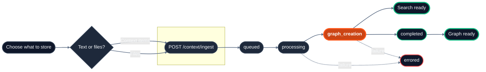

Context is everything you store in HydraDB: notes, preferences, decisions, conversations, files, and what connectors sync. Each stored unit is an **item** (a context item you sent, an uploaded file, or a record a connector synced). A database keeps every item in one corpus, and every endpoint in this group works on all of them. Ingestion returns an `id` for each item, and the other endpoints in this group take that `id`.

## Endpoint references

SDK methods are listed by their Python names. The TypeScript SDK uses the same names in camelCase, such as `context.updateSourceMetadata`.

| Endpoint | SDK method | Purpose |
| --- | --- | --- |
| [`POST /context/ingest`](/api-reference/v2/endpoint/ingest-context) | `context.ingest` | Ingest context items or files. Asynchronous: items are queued for indexing. |
| [`GET /context/status`](/api-reference/v2/endpoint/source-status) | `context.status` | Poll indexing progress |
| [`POST /context/list`](/api-reference/v2/endpoint/list-context) | `context.list` | Browse stored items |
| [`GET /context/inspect`](/api-reference/v2/endpoint/fetch-content) | `context.inspect` | Inspect an item's original content |
| [`PATCH /context/{id}/metadata`](/api-reference/v2/endpoint/update-source-metadata) | `context.update_source_metadata` | Update an item's metadata without re-ingesting |
| [`GET /context/relations`](/api-reference/v2/endpoint/source-relations) | `context.relations` | Inspect graph relations |
| [`GET /context/{id}/subgraph`](/api-reference/v2/endpoint/subgraph) | `context.subgraph` | Get everything connected to one item |
| [`DELETE /context`](/api-reference/v2/endpoint/delete-source) | `context.delete` | Delete items |

## Choose an ingest payload

`POST /context/ingest` accepts two payloads. Neither takes a `type`:

| To ingest | Send | Reference |
| :-- | :-- | :-- |
| User preferences, decisions, notes, conversation history, or any text you already have | `context`: a list of items, each a `text` or a `conversation` | [Context item fields](/api-reference/v2/endpoint/ingest-context#context-item-fields) |
| PDFs, DOCX, CSVs, and other files HydraDB should parse | `documents`, in a multipart form | [Supported file formats](/api-reference/v2/endpoint/ingest-context#supported-file-formats) |

## Typical call sequence

1. Ingest context: `POST /context/ingest`. The response returns an ID for each item.
2. Wait for indexing: poll `GET /context/status` with those IDs. An item is searchable at `graph_creation` and its graph is ready at `completed`. `errored` means indexing failed.
3. Retrieve context: `POST /query`.
4. Manage what is stored: list, inspect, update metadata, or delete by ID.



## Key concepts

- **One corpus:** Everything in a collection is searched together. `POST /query` needs no `type`; to keep one user's context apart from shared documents, put them in different collections and name the collections you want.
- **IDs:** `/context/ingest` returns an ID for each item. To assign your own, set `context_id` on a context item, or `id` in a file's `document_metadata` entry. Use IDs to poll status, inspect content, and delete context.
- **Metadata:** Set `attributes` (schema-backed, filterable with `attributes` on a query) and `custom_attributes` (free-form) on each item. [Metadata Filters](/essentials/v2/metadata) covers declaring, updating, and filtering metadata.
- **Labels:** `context_category` puts a label (`user_preference` or `business_knowledge`) on an item. It comes back on query chunks as `enrichment_kind` and can be filtered on in `POST /context/list`. It does not change how the item is processed.
- **Linked items:** Declare that items belong together with `forceful_relations` on the item that points at the others. In `thinking` mode, a query that finds that item also returns the linked items in `data.forceful_relations`:

```python Python SDK
import json

result = client.context.ingest(
    database="acme_corp",
    collection="team_docs",
    context=json.dumps([{
        "context_id": "runbook_deploy",
        "title": "Deploy runbook",
        "text": "Deploys run from the release branch after the change review is approved.",
        "custom_attributes": {"owner": "platform-team"},
        "forceful_relations": {"context_ids": ["monitoring_guide"]},
    }]),
)
```

## Related

- [Ingest Context](/api-reference/v2/endpoint/ingest-context): every item field, with examples
- [Context](/essentials/v2/context): ingesting context and waiting for indexing
- [Metadata Filters](/essentials/v2/metadata): schema-backed and free-form metadata
- [Query: Overview](/api-reference/v2/endpoint/query-overview): retrieve ingested context
