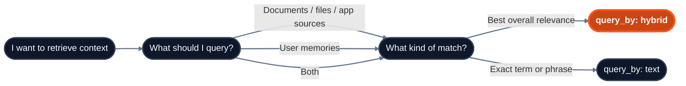

import { Field } from "/snippets/field.jsx";

A query returns ranked passages (**chunks**) and their source details. Choose what to search with `type`, how to match it with `query_by`, and how much retrieval work to do with `mode`. See [Query](/api-reference/v2/endpoint/query) for all request and response fields.



## Parameters that matter

| Parameter | Values | Use it for |
|---|---|---|
| <Field name="type" /> | `"knowledge"`, `"memory"`, `"all"` | Choose what to query. Use `"knowledge"` for shared docs/app sources, `"memory"` for user context, and `"all"` when an answer should use both. |
| <Field name="query_by" /> | `"hybrid"`, `"text"` | Choose the matching method. Use `"hybrid"` by default and `"text"` for exact terms or phrases. |
| <Field name="mode" /> | `"fast"`, `"thinking"`, `"auto"` | Use `"fast"` for a single pass, `"thinking"` for query expansion, reranking, and explicitly linked sources, or `"auto"` to let HydraDB choose. Default `"auto"`; it falls back to `"thinking"` when it cannot decide. |
| <Field name="max_results" /> | integer | Control prompt size. Default `10`, maximum `250`. Start with `10`, reduce for tight context windows, increase only when you rerank or summarize downstream. |
| <Field name="alpha" /> | `0.0` to `1.0`, or `"auto"` | Tune hybrid query. Lower values favor keyword matching; higher values favor semantic similarity. Default `0.8`, which `"auto"` also resolves to. |
| <Field name="attributes" /> | object | Narrow results by schema-backed metadata, using equality or comparison operators such as `$eq` and `$gte`. Free-form fields use `metadata_filters.additional_metadata`. |
| <Field name="collections" /> | `string[]` or weighted object | Search one or more collections. A list uses equal normalized weights; an object like `{ "workspace_42": 2, "user_alex": 1 }` applies relative ranking weights with at most one decimal place. Max 100 collections, and each must exist. |
| <Field name="graph_context" /> | boolean | Include entity/relation context with the chunks. On by default; set `false` with `mode: "fast"` for chunk-only responses (`thinking` always includes it). |
| <Field name="query_apps" /> | boolean | Adds app-aware retrieval while still querying the full selected knowledge scope. Use it for better app-source matching; it does not restrict retrieval to app sources only. On by default for knowledge queries; send `false` to turn it off. |

## Recommended configurations

| User intent | Recommended config |
|---|---|
| Fast answers from documents | `type="knowledge"`, `query_by="hybrid"`, `mode="fast"`, `max_results=5-10`, `graph_context=false` |
| Broader document search | `type="knowledge"`, `query_by="hybrid"`, `mode="thinking"` (thinking always includes graph context) |
| Personalized answer | `type="all"`, the user's `collection`, `query_by="hybrid"`, `mode="thinking"`. If shared docs live in another collection, list both in `collections` |
| User preferences only | `type="memory"`, include `collection`, `query_by="hybrid"` |
| Exact keyword or phrase | `type="knowledge"`, `query_by="text"`, `operator="phrase"` |
| Recent operational updates | `query_by="hybrid"`, `recency_bias=0.6-0.8`, filter to the right document type |
| Mixed or unpredictable query complexity | `query_by="hybrid"`, `mode="auto"`: let HydraDB route each query to `fast` or `thinking` |

## Typical patterns

<AccordionGroup>
  <Accordion title="Document Q&A from shared knowledge" defaultOpen>

Use this for answering questions from docs, PDFs, tickets, pages, or app sources.

```json
{
  "database": "acme",
  "query": "What is our refund policy?",
  "type": "knowledge",
  "query_by": "hybrid",
  "mode": "thinking",
  "max_results": 10,
  "graph_context": true
}
```

  </Accordion>

  <Accordion title="Personalized answer with memories">

Search the shared knowledge collection and the same collection used at memory ingestion. Both collections must already exist.

```json
{
  "database": "acme",
  "collections": ["company_docs", "user_alex"],
  "query": "What is our refund policy, and how should I explain it to this user?",
  "type": "all",
  "query_by": "hybrid",
  "mode": "thinking"
}
```

  </Accordion>

  <Accordion title="Search multiple collections">

Search several collections and return one ranked result set. Use a list for equal weighting, or an object to give one collection more influence.

```json
{
  "database": "acme",
  "collections": {
    "workspace_42": 2,
    "user_alex": 1
  },
  "query": "What renewal risks should we discuss?",
  "type": "all",
  "query_by": "hybrid",
  "mode": "thinking"
}
```

  </Accordion>

  <Accordion title="Filtered query for a specific slice">

Metadata filters work like SQL `WHERE` clauses: they limit which context a query can return. Use `attributes` for schema-backed fields declared in `database_metadata_schema`. Put free-form filters under `metadata_filters.additional_metadata`. The filters are combined with AND.

```json
{
  "database": "acme",
  "query": "What launch constraints apply to enterprise customers?",
  "type": "knowledge",
  "query_by": "hybrid",
  "attributes": {"department": "product"},
  "metadata_filters": {
    "additional_metadata": {
      "source": "launch_plan"
    }
  }
}
```

  </Accordion>

  <Accordion title="Exact phrase lookup">

Use text query when literal wording matters: legal clauses, SKUs, error codes, IDs, or compliance references.

```json
{
  "database": "acme",
  "query": "GDPR Article 17",
  "type": "knowledge",
  "query_by": "text",
  "operator": "phrase"
}
```

  </Accordion>
</AccordionGroup>

## Response summary

By default, `POST /query` returns `data.llm_prompt`, the retrieved context formatted as Markdown for your model. The response also includes ranked `data.chunks[]`, deduplicated `data.sources[]`, and graph and related-source fields. If you format those structured fields yourself, preserve chunk order. Use `response_format: "structured"` to omit the prompt string, or `"markdown"` to return it directly as `data`. See [How to Use API Results](/essentials/v2/api-results) for model calls and citations.

## Related sections

- [Query](/api-reference/v2/endpoint/query): full endpoint reference
- [Usage: Query](/essentials/v2/query): conceptual overview, retrieval modes, and ranking behavior
- [Usage: Metadata](/essentials/v2/metadata): filtering with database and document metadata
- [Concepts: Context Graphs](/essentials/v2/context-graphs): graph context and relation paths
