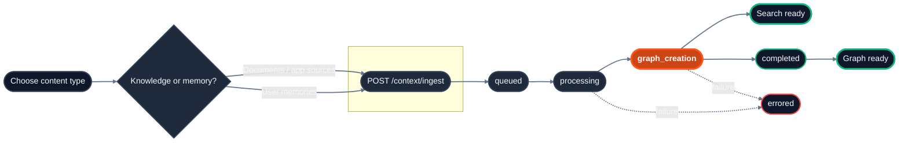

Context is everything you store in HydraDB: knowledge and memories. Each stored unit is a **source** (an uploaded document, an app source, or a memory). Ingestion returns an `id` for each source, and the other endpoints in this group take that `id`.

## Endpoint references

SDK methods are listed by their Python names. The TypeScript SDK uses the same names in camelCase, such as `context.updateSourceMetadata`.

| Endpoint | SDK method | Purpose |
| --- | --- | --- |
| [`POST /context/ingest`](/api-reference/v2/endpoint/ingest-context) | `context.ingest` | Ingest documents, app sources, or memories. Asynchronous: sources are queued for indexing. |
| [`GET /context/status`](/api-reference/v2/endpoint/source-status) | `context.status` | Poll indexing progress |
| [`POST /context/list`](/api-reference/v2/endpoint/list-documents) | `context.list` | Browse stored sources or memories |
| [`GET /context/inspect`](/api-reference/v2/endpoint/fetch-content) | `context.inspect` | Inspect original source content |
| [`PATCH /context/{id}/metadata`](/api-reference/v2/endpoint/update-source-metadata) | `context.update_source_metadata` | Update a source's metadata without re-ingesting |
| [`GET /context/relations`](/api-reference/v2/endpoint/source-relations) | `context.relations` | Inspect graph relations |
| [`GET /context/{id}/subgraph`](/api-reference/v2/endpoint/subgraph) | `context.subgraph` | Get everything connected to one source |
| [`DELETE /context`](/api-reference/v2/endpoint/delete-source) | `context.delete` | Delete sources or memories |

## Choose an ingest payload

`POST /context/ingest` accepts three payloads. `type` picks the store, and within `type=knowledge` you pick the payload shape:

| To ingest | Send | Guide |
| :-- | :-- | :-- |
| PDFs, DOCX, CSVs, and other documents HydraDB should parse | `type=knowledge` and `documents` | [Knowledge](/essentials/v2/knowledge) |
| Slack messages, Notion pages, Gmail threads, or web pages with pre-extracted text | `type=knowledge` and `app_knowledge` | [App Sources](/essentials/v2/app-sources) |
| User preferences, conversation history, or inline notes | `type=memory` and `memories` | [Memories](/essentials/v2/memories) |

You can send `documents` and `app_knowledge` in the same request.

## Typical call sequence

1. Ingest context: `POST /context/ingest`. The response returns an ID for each source.
2. Wait for indexing: poll `GET /context/status` with those IDs. A source is searchable at `graph_creation` and its graph is ready at `completed`. `errored` means indexing failed.
3. Retrieve context: `POST /query`.
4. Manage what is stored: list, inspect, update metadata, or delete by ID.



## Key concepts

- **Knowledge and memories:** Knowledge is the documents, app sources, and facts your AI uses. Memories are preferences, decisions, and past conversations. Both live in a collection, and `type: "all"` on `POST /query` searches both from the same scope.
- **IDs:** `/context/ingest` returns an ID for each source. To assign your own, set `id` in the `document_metadata`, `app_knowledge`, or `memories` item. Use IDs to poll status, inspect content, and delete context.
- **Metadata:** [Metadata and Filters](/essentials/v2/metadata) covers metadata fields, ingestion, updates, and filtering.
- **Forceful relations:** Links you declare between sources with `relations.ids`. In `thinking` mode, a query returns the linked sources in `additional_context` alongside the matching chunks. Set relations on the same `document_metadata` item as the file's metadata:

```python Python SDK
import json

with open("runbook.pdf", "rb") as f:
    result = client.context.ingest(
        type="knowledge",
        database="acme_corp",
        documents=[("runbook.pdf", f, "application/pdf")],
        document_metadata=json.dumps([{
            "id": "runbook_deploy",
            "metadata": {"department": "ops"},
            "additional_metadata": {"owner": "platform-team"},
            "relations": {"ids": ["monitoring_guide"]},
        }]),
    )
```

## Related

- [Knowledge: forceful relations](/essentials/v2/knowledge#7-forceful-relations): linking sources at ingestion
- [Memories](/essentials/v2/memories): memories and knowledge, and when to use which
- [Metadata and Filters](/essentials/v2/metadata): schema-backed and free-form metadata
- [Query: Overview](/api-reference/v2/endpoint/query-overview): retrieve ingested context
