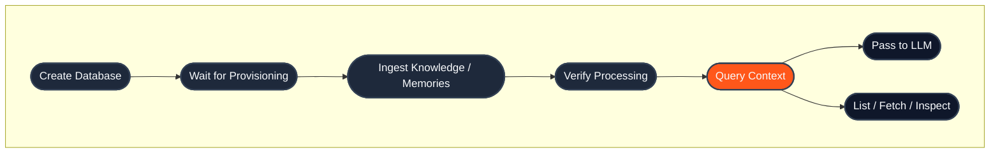

Use this reference to look up request fields and response formats. If you are new to HydraDB, the [Quickstart](/get-started/v2/quickstart) gets you to a first query in five minutes. AI agents can start from the [Agent Integration Guide](/AGENTS) and the [v2 OpenAPI spec](/api-reference/v2/openapi.json).

## The four calls

Create a database, ingest context, wait for indexing, then query it.

1. [Create Database](/api-reference/v2/endpoint/create-database): `POST /databases`. Isolates context for a customer, environment, or product. Creation runs in the background, so poll [Database Status](/api-reference/v2/endpoint/database-status) until `ready_for_ingestion` is `true`.
2. [Ingest Context](/api-reference/v2/endpoint/ingest-context): `POST /context/ingest`. Files, app sources, or memories, in one multipart request.
3. [Ingestion Status](/api-reference/v2/endpoint/source-status): `GET /context/status`. Poll the returned IDs until `indexing_status` is `completed`, or [register a webhook](/api-reference/v2/endpoint/webhooks-overview) instead.
4. [Query](/api-reference/v2/endpoint/query): `POST /query`. Retrieve the context your model needs, from knowledge, memories, or both.



## Every endpoint

SDK methods are listed by their Python names. The TypeScript SDK uses the same names in camelCase, such as `deleteCollection`. Every endpoint page shows Python SDK, TypeScript SDK, and cURL examples, and each group overview covers that group's call sequence and concepts.

### Databases

Create and manage the databases that store your context. [Overview](/api-reference/v2/endpoint/databases-overview).

| Endpoint | SDK method | Purpose |
|---|---|---|
| [`POST /databases`](/api-reference/v2/endpoint/create-database) | `databases.create` | Create a database |
| [`GET /databases/{database}/metadata-schema`](/api-reference/v2/endpoint/get-metadata-schema) | `databases.get_metadata_schema` | Read metadata schema fields |
| [`PATCH /databases/{database}/metadata-schema`](/api-reference/v2/endpoint/update-metadata-schema) | `databases.update_metadata_schema` | Add metadata schema fields |
| [`GET /databases`](/api-reference/v2/endpoint/list-databases) | `databases.list` | List databases |
| [`DELETE /databases`](/api-reference/v2/endpoint/delete-database) | `databases.delete` | Delete a database |
| [`GET /databases/status`](/api-reference/v2/endpoint/database-status) | `databases.status` | Check provisioning readiness |
| [`GET /databases/collections`](/api-reference/v2/endpoint/list-collections) | `databases.collections` | List active collections |
| [`DELETE /databases/collections`](/api-reference/v2/endpoint/delete-collection) | `databases.delete_collection` | Delete a collection |
| [`GET /databases/stats`](/api-reference/v2/endpoint/database-stats) | `databases.stats` | Get usage statistics |

### Context

Ingest, check, list, inspect, edit, and delete what you store. [Overview](/api-reference/v2/endpoint/context-overview).

| Endpoint | SDK method | Purpose |
|---|---|---|
| [`POST /context/ingest`](/api-reference/v2/endpoint/ingest-context) | `context.ingest` | Ingest knowledge or memories |
| [`GET /context/status`](/api-reference/v2/endpoint/source-status) | `context.status` | Check indexing status |
| [`GET /context/inspect`](/api-reference/v2/endpoint/fetch-content) | `context.inspect` | Read original source content or get a presigned URL |
| [`POST /context/list`](/api-reference/v2/endpoint/list-context) | `context.list` | Browse knowledge or memories |
| [`PATCH /context/{id}/metadata`](/api-reference/v2/endpoint/update-source-metadata) | `context.update_source_metadata` | Update source metadata |
| [`DELETE /context`](/api-reference/v2/endpoint/delete-source) | `context.delete` | Delete knowledge or memories |
| [`GET /context/relations`](/api-reference/v2/endpoint/source-relations) | `context.relations` | Inspect entity relationships |
| [`GET /context/{id}/subgraph`](/api-reference/v2/endpoint/subgraph) | `context.subgraph` | Get the connected subgraph |

### Query

Retrieve context, and tell HydraDB how a query performed. [Overview](/api-reference/v2/endpoint/query-overview).

| Endpoint | SDK method | Purpose |
|---|---|---|
| [`POST /query`](/api-reference/v2/endpoint/query) | `query` | Query knowledge, memories, or both |
| [`POST /feedback`](/api-reference/v2/endpoint/submit-feedback) | `feedback.submit` | Submit query feedback |

### Connectors

Sync context from 70 apps without writing ingestion code. [Overview](/api-reference/v2/endpoint/connectors-overview).

| Endpoint | SDK method | Purpose |
|---|---|---|
| [`GET /connectors/providers`](/api-reference/v2/endpoint/list-connector-providers) | `list_providers` | List connector providers |
| [`POST /connectors`](/api-reference/v2/endpoint/create-connector) | `connectors.create` | Create a connector |
| [`GET /connectors/{id}/discover`](/api-reference/v2/endpoint/discover-connector-resources) | `connectors.discover` | Discover resources |
| [`POST /connectors/{id}/configure`](/api-reference/v2/endpoint/configure-connector) | `connectors.configure` | Configure a connector |
| [`GET /connectors/{id}/status`](/api-reference/v2/endpoint/get-connector-status) | `connectors.status` | Get connector status |
| [`GET /connectors`](/api-reference/v2/endpoint/list-connectors) | `connectors.list` | List connectors |
| [`GET /connectors/{id}`](/api-reference/v2/endpoint/get-connector) | `connectors.get` | Get a connector |
| [`GET /connectors/{id}/resources`](/api-reference/v2/endpoint/connector-resources) | `connectors.list_resources` | List connector resources |
| [`POST /connectors/{id}/sync`](/api-reference/v2/endpoint/sync-connector) | `connectors.sync` | Sync a connector |
| [`POST /connectors/{id}/pause`](/api-reference/v2/endpoint/pause-connector) | `connectors.pause` | Pause a connector |
| [`POST /connectors/{id}/resume`](/api-reference/v2/endpoint/resume-connector) | `connectors.resume` | Resume a connector |
| [`PATCH /connectors/{id}`](/api-reference/v2/endpoint/update-connector) | `connectors.update` | Update a connector |
| [`PATCH /connectors/{id}/resources/{resource_id}`](/api-reference/v2/endpoint/update-connector-resource) | `connectors.update_resource_acl` | Update a connector resource |
| [`POST /connectors/{id}/resources`](/api-reference/v2/endpoint/add-connector-resource) | `connectors.create_resource` | Add a connector resource |
| [`DELETE /connectors/{id}/resources/{resource_id}`](/api-reference/v2/endpoint/delete-connector-resource) | `connectors.delete_resource` | Delete a connector resource |
| [`DELETE /connectors/{id}`](/api-reference/v2/endpoint/delete-connector) | `connectors.delete` | Delete a connector |

### Webhooks

Get notified when indexing finishes instead of polling. [Overview](/api-reference/v2/endpoint/webhooks-overview).

| Endpoint | SDK method | Purpose |
|---|---|---|
| [`POST /webhooks/indexing`](/api-reference/v2/endpoint/register-webhook) | `webhooks.register` | Register a webhook |
| [`GET /webhooks/indexing`](/api-reference/v2/endpoint/get-webhook) | `webhooks.get` | Get the webhook |
| [`DELETE /webhooks/indexing`](/api-reference/v2/endpoint/delete-webhook) | `webhooks.delete` | Delete the webhook |
| [`POST /webhooks/indexing/test`](/api-reference/v2/endpoint/test-webhook) | `webhooks.test` | Send a test delivery |
| [`GET /webhooks/indexing/deliveries`](/api-reference/v2/endpoint/list-webhook-deliveries) | `webhooks.list_deliveries` | List deliveries |
| [`GET /webhooks/indexing/deliveries/{delivery_id}`](/api-reference/v2/endpoint/get-webhook-delivery) | `webhooks.get_delivery` | Get a delivery |
| [`POST /webhooks/indexing/deliveries/{delivery_id}/retry`](/api-reference/v2/endpoint/retry-webhook-delivery) | `webhooks.retry_delivery` | Retry a delivery |
| [`POST /webhooks/indexing/signing-secret`](/api-reference/v2/endpoint/set-webhook-signing-secret) | `webhooks.set_signing_secret` | Generate or replace the signing secret |
| [`DELETE /webhooks/indexing/signing-secret`](/api-reference/v2/endpoint/disable-webhook-signing) | `webhooks.clear_signing_secret` | Disable signing |

## Conventions

**Authentication:** Every endpoint requires `Authorization: Bearer <your_api_key>`. Get your key at [dashboard.hydradb.com](https://dashboard.hydradb.com). The [SDKs](/api-reference/v2/sdks) set it, and the version header, for you.

**Versioning:** Send `API-Version: 2` with every request.

```bash
curl -X POST 'https://api.hydradb.com/query' \
  -H "Authorization: Bearer <your_api_key>" \
  -H "API-Version: 2" \
  -H "Content-Type: application/json" \
  -d '{
    "database": "my_first_database",
    "query": "What are the pricing tiers?",
    "type": "knowledge",
    "query_by": "hybrid"
  }'
```

**Response envelope:** Core v2 endpoints (`/databases`, `/context/*`, `/query`, `/feedback`, and `/webhooks/indexing*`) return the same envelope, with the resource-specific payload under `data`. Connector endpoints (`/connectors*`) and `PATCH /databases/{database}/metadata-schema` are the exception: they return their success body without the envelope.

```json
{
  "success": true,
  "data": {},
  "error": null,
  "meta": {
    "request_id": "request-id",
    "latency_ms": 12.3
  }
}
```

**Errors:** Every endpoint returns errors in the same envelope, with `success: false` and an `error` object containing `code` and `message`. Most errors have `data: null`. Some [Delete Context](/api-reference/v2/endpoint/delete-source) errors include per-ID results under `data`. See [Error Responses](/api-reference/v2/error-responses) for error codes and retry rules.

**Status codes:** `200` for success and `202` when an asynchronous operation is queued.

**Database scoping:** Use `database` to select a database and `collection` to scope context within it. Omitting `collection` uses the default collection. Requests that use the deprecated tenant field names can include deprecation notices. See [Migrating from tenant fields](/essentials/v2/databases-and-collections#7-migrating-from-the-legacy-tenant-and-sub-tenant-fields).

**Asynchronous operations:** Database creation, database and collection deletion, and context ingestion are asynchronous. They return immediately after queuing. Use the relevant status endpoint to confirm completion before downstream operations.

**Pagination:** Listing endpoints (`/context/list`) return pagination fields for browsing large result sets.

**Parameter casing:** The REST API uses snake_case (`database`, `max_results`). The TypeScript SDK uses camelCase keys and method names (`maxResults`, `deleteCollection`) and ignores request keys it does not recognize, including snake_case ones. The Python SDK uses snake_case throughout. See [SDKs](/api-reference/v2/sdks#naming-conventions).

## Rate limits

Rate limits apply per API key. Both SDKs retry `429` responses automatically. For raw HTTP, use exponential backoff; see [Error Responses](/api-reference/v2/error-responses#retry-pattern). Contact [founders@hydradb.com](mailto:founders@hydradb.com) for current limit values.

## Next steps

Existing v1 endpoints remain available under the v1 API Reference.

- **Set up an SDK:** [SDKs](/api-reference/v2/sdks) covers installation, client setup, and the method reference. Packages: [Python](https://pypi.org/project/hydradb-sdk/) · [TypeScript](https://www.npmjs.com/package/@hydradb/sdk)
- **Handle errors:** [Error Responses](/api-reference/v2/error-responses) lists status codes, error codes, and retry rules
- **Tune queries:** The [Query guide](/essentials/v2/query) explains retrieval modes and ranking
