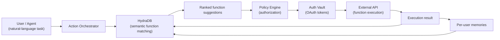

An AI that doesn't just answer questions - it *takes action*. Register every callable function in your workspace as a knowledge object in HydraDB. Any agent or user can say "prepare for tomorrow's board meeting" and receive a structured, personalized execution plan: which functions to call, in which order, with which parameters. Every API call is real and copy-paste ready.


---


Most AI assistants are read-only. They answer questions, summarize documents, and draft emails. What they can't do is *act* - book the meeting, update the CRM, send the Slack message, trigger the deployment. To cross that threshold, the agent needs to know not just what functions exist in your workspace, but which one to call for any given task, in what order, with what parameters, and for which user.


This cookbook builds an **AI Chief of Staff** - an autonomous reasoning layer that turns natural language into structured function calls across every app in your stack. Think of it as n8n, but driven by intent rather than rigid if-then workflows. You register your callable functions into HydraDB as knowledge objects. Any agent then asks HydraDB: *"What should I do for this task?"* HydraDB returns the right function, the right parameters, and the right sequence - all personalized to the requesting user's preferences and the current context.


The architectural insight is separation of concerns: your primary LLM handles conversation and intent extraction, while HydraDB becomes the **function selection oracle** - a reasoning layer that has learned which functions work for which tasks, which sequences tend to succeed together, and how individual users prefer to work. Over time, it builds institutional knowledge that your agents can tap into.


ℹ️
> **All code in this cookbook is real.** Base URL: `https://api.hydradb.com`. Get your API key at [app.hydradb.com](https://app.hydradb.com).


## Prerequisites

**Required knowledge**: Python basics, REST APIs, environment variables, basic understanding of OAuth  
**Required tools**:
- HydraDB API key
- Python 3.11 or 3.12 (`python --version`)
- OpenAI API key (for parameter extraction and plan sequencing)
- `pip install hydradb-sdk openai slack-sdk flask backoff`

## What You'll Build

By the end of this cookbook, you'll be able to:
- Register any workspace function (Slack, Calendar, CRM, Jira) as a HydraDB knowledge object so agents can discover it semantically
- Build an Orchestrator that translates a natural-language task into an authorized, token-injected API call
- Generate multi-step execution plans for complex tasks like "onboard the new hire"
- Store per-user preference memory so HydraDB personalizes function suggestions over time
- Feed execution outcomes back into HydraDB to close the self-improvement loop


**❌ // Traditional automation (n8n, Zapier, Make)**

- Rigid if-then workflows - break when conditions change
- Every automation hardcoded - no personalization
- No memory of past executions or user preferences
- Requires manual mapping of triggers to actions
- Context window resets on every run

**✅ // HydraDB AI Chief of Staff**

- Intent-driven routing - adapts to how requests are phrased
- Per-user personalization via AI Memories
- Learns function composition patterns from execution history
- One natural language request returns a full execution plan
- Compound intelligence - every run makes future runs smarter


## How HydraDB Enables This


Four HydraDB capabilities make a Chief of Staff possible:


- **Functions as knowledge objects** - each callable function is uploaded to HydraDB via `POST /context/ingest` with `type: "function"`. The function's natural-language description becomes the retrieval surface. HydraDB matches tasks to functions semantically - not by keyword - so "tell the team about the delay" correctly surfaces `send_slack_announcement` even though neither word appears in the function name.
- **Personalized function selection** - when a user frequently chooses Slack over email for urgent updates, HydraDB's AI Memories encode that preference. Future function suggestions for that user automatically favour `send_slack_message` over `send_email`. This happens without any manual configuration - the pattern emerges from usage stored via `POST /context/ingest`.
- **Multi-step plan generation** - `mode: "thinking"` on `POST /query` enables multi-query reasoning. Ask HydraDB to return a JSON array of functions with dependencies and it decomposes a complex request like "onboard the new hire" into a sequenced execution plan automatically.
- **Self-improving function routing** - feeding execution results back to HydraDB via `POST /context/ingest` closes the learning loop. Slow functions, failed calls, and successful sequences all become training signal. The agent gets measurably smarter with every run, without any manual tuning.


## Architecture


One HydraDB database. Functions registered as knowledge objects. An Action Orchestrator that translates HydraDB suggestions into real API calls. Per-user memories that personalize every suggestion.





The flow: a user or agent sends a natural-language task to the Action Orchestrator. The Orchestrator queries HydraDB, which matches the task semantically against registered function knowledge objects and returns a ranked suggestion. The Orchestrator executes the function via the real API, logs the result back to HydraDB as a memory, and the loop closes. Each execution makes the next suggestion smarter.


ℹ️
> **The Orchestrator is thin by design.** It has no opinion about which function to call - that decision belongs to HydraDB. The Orchestrator's only job is: receive suggestion, authorize it against the policy engine, inject the correct OAuth token from the auth vault, call the real API, and report the outcome. All routing intelligence lives in HydraDB.


 STEP 1 


## Create Database


One database for the whole Chief of Staff system. All functions, all user memories, and all execution history live under this database. Collections scope function access per team or department - the sales team's agent only sees sales functions, the engineering team's agent only sees deployment and monitoring functions.

Install the Python packages used by the examples and set both API keys:

```bash
pip install requests openai
export HYDRADB_API_KEY="your_hydradb_key"
export OPENAI_API_KEY="your_openai_key"
```

HydraDB handles retrieval and memory. The OpenAI SDK is used only in the app layer for turning retrieved function schemas into executable parameters and multi-step plans; you can replace it with any LLM provider.

```python title="setup.py"
import os
from hydra_db import HydraDB

API_KEY   = os.environ["HYDRADB_API_KEY"]
TENANT_ID = "chief-of-staff"

client = HydraDB(token=API_KEY)

def create_tenant():
    """Create the main database. Idempotent - safe to call multiple times."""
    client.databases.create(database=TENANT_ID)
    print(f"Database '{TENANT_ID}' ready.")

# Collections scope functions per team. Created automatically on first write.
# Sales agents only see sales functions. Engineering agents only see deploy functions.
# Examples:
#   collection = "sales"        → CRM, calendar, email, proposals
#   collection = "engineering"  → deploys, incidents, GitHub, monitoring
#   collection = "executive"    → board decks, reporting, scheduling
#   collection = "hr"           → hiring, onboarding, HRIS actions

if __name__ == "__main__":
    create_tenant()
```

Output:
```
Database 'chief-of-staff' ready.
```


 STEP 2 


## Define & Register Functions


Every action your Chief of Staff can take must be registered in HydraDB as a knowledge object. HydraDB treats each function as a document: its natural-language description is the retrieval surface, its schema is the execution contract, and its metadata controls who can access it and under what conditions.


The quality of your function descriptions directly determines routing accuracy. Write descriptions that explain *what the function achieves* and *when it should be used*, not just what it does technically. HydraDB reasons over these descriptions during function selection.


### Function schema


Each function schema has four components: `id` (stable identifier for versioning and logging), `description` (the natural-language surface HydraDB matches tasks against - write this carefully), `parameters` (JSON Schema for the execution contract), and `meta` (access control, constraints, and routing hints).


```json title="schemas/send_slack_message.json"
{
  "id": "send_slack_message",
  "name": "Send a Slack message",
  "description": "Posts a message to a Slack channel or DM on behalf of the user. Use this when the user wants to notify a team, send an update, share information with a colleague, or make an announcement. Prefer this over send_email for internal, time-sensitive, or informal communications.",
  "parameters": {
    "type": "object",
    "properties": {
      "channel":   { "type": "string",  "description": "#channel-name or @username or user ID" },
      "text":      { "type": "string",  "description": "Message body - supports Slack mrkdwn" },
      "thread_ts": { "type": "string",  "description": "Optional. Reply in thread by passing parent message ts." }
    },
    "required": ["channel", "text"]
  },
  "auth": {
    "oauth_provider": "slack",
    "scopes": ["chat:write"]
  },
  "meta": {
    "collections":       ["communication", "slack"],
    "side_effects":      "Sends a visible message. Cannot be unsent programmatically.",
    "idempotent":        false,
    "permissions":       ["all_users"],
    "business_hours_only": false
  }
}
```


💡
> **The description field is your routing budget.** HydraDB matches tasks to functions by reading the description semantically. Include: (1) what the function *achieves*, not just what it does, (2) when it should be preferred over similar functions, and (3) any important constraints or side effects. A description like *"Posts a Slack message"* routes poorly. A description that explains "Use this for internal, time-sensitive, or informal communications - prefer over send_email" routes correctly even when the user says "ping the team".


Here is a more complex schema - a finance function with approval constraints and metadata filters that prevent it from being suggested outside authorized contexts:


```json title="schemas/approve_expense.json"
{
  "id": "approve_expense",
  "name": "Approve an expense report",
  "description": "Approves a pending expense report in the finance system. Use when a manager or finance lead needs to sign off on submitted expenses. Always confirm the amount and submitter before calling. Do not suggest this function outside business hours or for users without manager-level permissions.",
  "parameters": {
    "type": "object",
    "properties": {
      "expense_id":  { "type": "string", "description": "Expense report ID from finance system" },
      "approver_id": { "type": "string", "description": "User ID of the approving manager" },
      "note":        { "type": "string", "description": "Optional approval note for audit log" }
    },
    "required": ["expense_id", "approver_id"]
  },
  "meta": {
    "department":         "finance",
    "permission_level":   "manager",
    "cost_threshold":     5000,
    "requires_approval":  true,
    "approval_preview_fields": ["expense_id", "approver_id"],
    "business_hours_only": true,
    "collections":        ["finance", "approvals"],
    "side_effects":       "Triggers payment processing. Irreversible without finance team intervention.",
    "idempotent":         false
  }
}
```

The finance action always requires approval. `cost_threshold` can also require approval for functions that don't set `requires_approval`; the amount must come from your trusted finance system, not a model's estimate.


### Upload to HydraDB


Upload functions using the same `POST /context/ingest` endpoint used for documents. Set `type: "function"` and include the full JSON schema as the content body. Group functions into collections so HydraDB can scope retrieval per team without returning irrelevant options.


```python title="register/upload_functions.py"
import json, time, os
from hydra_db import HydraDB

# All functions in the workspace. Each schema loaded from its own file.
FUNCTION_SCHEMAS = [
    "schemas/send_slack_message.json",
    "schemas/send_email.json",
    "schemas/create_calendar_event.json",
    "schemas/update_crm_opportunity.json",
    "schemas/create_jira_ticket.json",
    "schemas/approve_expense.json",
    "schemas/trigger_deployment.json",
    "schemas/notify_pagerduty.json",
    "schemas/generate_report.json",
    "schemas/add_to_notion.json",
]

client = HydraDB(token=os.environ["HYDRADB_API_KEY"])
TENANT_ID = "chief-of-staff"


def load_schema(path: str) -> dict:
    with open(path) as f:
        return json.load(f)

def upload_functions(schema_paths: list, collection: str = "functions") -> list:
    """
    Upload function schemas to HydraDB as knowledge objects.
    collection: scopes which agents can see these functions.
    Use per-team collections to limit scope and improve routing precision.

    Tip: re-running this is idempotent - HydraDB upserts on 'id'.
    """
    batch   = []
    all_ids = []

    for path in schema_paths:
        schema = load_schema(path)
        fn_id  = schema["id"]

        batch.append({
            "id":        fn_id,
            "title":     schema["name"],
            "type":      "function",     # tells HydraDB this is callable
            "timestamp": "2025-01-01T00:00:00Z",
            "content":   {"text": json.dumps(schema, indent=2)},
            "metadata": {
                "type":         "function",
                "collections":  schema.get("meta", {}).get("collections", []),
                "department":   schema.get("meta", {}).get("department", "all"),
                "permissions":  schema.get("meta", {}).get("permissions", ["all_users"]),
                "idempotent":   schema.get("meta", {}).get("idempotent", True),
                "side_effects": schema.get("meta", {}).get("side_effects", ""),
            },
        })

        if len(batch) == 20:
            all_ids += _upload_batch(batch, collection)
            batch = []; time.sleep(1)

    if batch:
        all_ids += _upload_batch(batch, collection)

    print(f"Functions: {len(all_ids)} schemas accepted for indexing.")
    return all_ids


def _upload_batch(batch: list, collection: str) -> list:
    data = client.context.ingest(
        database=TENANT_ID,
        collection=collection,
        app_knowledge=json.dumps(batch),
    )
    results = data.data.results if data.data else []
    accepted = [item.id for item in (results or []) if item.id and item.status in {"queued", "processing", "completed"}]
    if len(accepted) != len(batch):
        print(f"Accepted {len(accepted)} functions; inspect per-item errors: {results}")
    if not accepted:
        raise RuntimeError("No function schemas were accepted")
    return accepted


# Upload all functions (all teams, scoped to "functions" collection)
# For team-scoped variants, call again with collection="sales", "engineering", etc.
if __name__ == "__main__":
    upload_functions(FUNCTION_SCHEMAS, collection="functions")
```

Output:
```
Functions: 10 schemas accepted for indexing.
```


⚠️
> **Use team-scoped collections for precision.** If your function library grows to 50+ functions, a single `collection="functions"` will degrade routing quality because HydraDB must rank more candidates per query. Instead, upload sales functions to `collection="sales"`, engineering functions to `collection="engineering"`, and so on. Agents query only their team's collection. Fewer candidates = more accurate suggestions. Aim for fewer than 30 functions per collection for optimal routing.


### Versioning & deprecation


As functions evolve, use a `_v2` suffix on the ID for new versions. Mark deprecated versions in metadata so HydraDB stops routing to them while preserving historical execution records. Never delete old function objects - they anchor memory traces from past executions.


```python title="register/versioning.py"
import json, os
from hydra_db import HydraDB

client = HydraDB(token=os.environ["HYDRADB_API_KEY"])
TENANT_ID = "chief-of-staff"


def deprecate_function(fn_id: str, collection: str, reason: str):
    """
    Mark a function as deprecated so HydraDB stops suggesting it.
    Never delete - old executions reference this ID for audit and provenance.
    Use 'deprecated: true' in metadata + upload new version as fn_id_v2.
    """
    client.context.ingest(
        database=TENANT_ID,
        collection=collection,
        app_knowledge=json.dumps([{
            "id":        fn_id,
            "title":     f"[DEPRECATED] {fn_id}",
            "type":      "function",
            "timestamp": "2025-01-01T00:00:00Z",
            "content":   {"text": f"DEPRECATED: {reason}. Use {fn_id}_v2 instead."},
            "metadata": {
                "deprecated":         True,
                "deprecated_reason":  reason,
                "successor_id":       f"{fn_id}_v2",
            },
        }]),
    )
    print(f"Deprecated {fn_id}. Successor: {fn_id}_v2")


# Example: old create_calendar_event used Google Calendar v3 API (now sunset)
# New version uses Google Calendar v4 with conferencing support
deprecate_function(
    fn_id="create_calendar_event",
    collection="functions",
    reason="Google Calendar v3 API sunset. Migrated to v4 with conferencing support.",
)
```


 STEP 3 


## Build the Action Orchestrator


The Orchestrator is the runtime layer between HydraDB suggestions and real API calls. It receives a natural-language task, asks HydraDB which function solves it, authorizes the call against the policy engine, injects the correct OAuth token, executes the API, and logs the outcome back to HydraDB. It has no opinion about which function to call - that belongs to HydraDB entirely.


### Core orchestrator class


```python title="orchestrator/core.py"
import uuid, json, os
from openai import OpenAI
from hydra_db import HydraDB

client = HydraDB(token=os.environ["HYDRADB_API_KEY"])
TENANT_ID = "chief-of-staff"

class ChiefOfStaffOrchestrator:
    """
    The Orchestrator bridges HydraDB function suggestions and real workspace APIs.
    It does NOT decide which function to call - that is HydraDB's job.
    It does: authorize, inject tokens, execute, log outcomes.
    """

    def __init__(self, registry: dict, policy_engine, auth_vault, schemas=None, approvals=None):
        """
        registry:     Map of function_id → callable that executes the real API call.
        policy_engine: Object with .check(user, function_id, schema) → bool
        auth_vault:   Object with .get_token(user_id, oauth_provider) → str
        schemas:      Reviewed local schemas keyed by function_id.
        approvals:    Trusted ApprovalStore; missing means approval-required calls wait.
        """
        self.registry      = registry
        self.policy        = policy_engine
        self.vault         = auth_vault
        self.llm           = OpenAI()
        self.schemas       = schemas or {}
        self.approvals     = approvals

    def handle_task(
        self,
        task:        str,   # natural language - "book a 30-min call with alice next tuesday"
        user_id:     str,
        session_id:  str = None,
        sub_tenant:  str = "functions",
    ) -> dict:
        """
        Single-function task handling.
        1. Ask HydraDB which function to call.
        2. Authorize against policy engine.
        3. Extract parameters and request approval when required.
        4. After approval, inject a token and execute through the shared gate.
        5. Log the result back to HydraDB as memory.
        """
        session_id = session_id or str(uuid.uuid4())

        # Step 1 - Ask HydraDB for the best function
        search = client.query(
            database=TENANT_ID,
            collection=sub_tenant,
            query=task,
            max_results=5,
            mode="thinking",
            metadata_filters={"deprecated": False},
        )

        chunks = search.data.chunks or []
        if not chunks:
            return {"status": "no_match", "message": "No function found for this task."}

        top_chunk   = chunks[0]
        function_id = json.loads(top_chunk.chunk_content)["id"]
        schema = self.schemas.get(function_id)
        if schema is None or not self.policy.check(user_id, function_id, schema):
            self._log_blocked(user_id, task, function_id)
            return {"status": "blocked", "reason": "Policy denied this function or its schema is missing."}
        params = self._extract_params(task, schema, user_id, session_id)
        return self.execute_function(function_id, user_id, params, task=task)

    def execute_function(self, function_id, user_id, params, task="", approval_id=None):
        schema = self.schemas.get(function_id)
        if schema is None or not self.policy.check(user_id, function_id, schema):
            self._log_blocked(user_id, task, function_id)
            return {"status": "blocked", "reason": "Policy denied this function or its schema is missing."}

        params = {key: value for key, value in params.items() if not key.startswith("_")}
        exec_fn = self.registry.get(function_id)
        if not exec_fn:
            return {"status": "error", "message": f"No executor registered for {function_id}."}

        if approval_id is not None or self.policy.requires_approval(user_id, schema, params):
            if self.approvals is None:
                return {"status": "pending", "reason": "Approval service is not configured; nothing executed."}
            if approval_id is None:
                approval_id = self.approvals.request_approval(user_id, function_id, params, task)
                return {"status": "pending", "approval_id": approval_id}
            decision = self.approvals.consume(approval_id, user_id, function_id, params)
            if decision != "approved":
                return {"status": "pending" if decision == "pending" else "blocked", "approval_id": approval_id, "reason": decision}

        oauth_provider = schema.get("auth", {}).get("oauth_provider")
        if oauth_provider:
            params["_token"] = self.vault.get_token(user_id, oauth_provider)
        result = exec_fn(params)
        self._log_execution(user_id, task, function_id, params, result)
        return {"status": "done", "function_id": function_id, "result": result}

    def resume_approval(self, approval_id, user_id):
        record = self.approvals.get(approval_id) if self.approvals else None
        if not record or record["user_id"] != user_id:
            return {"status": "blocked", "reason": "Unknown approval or wrong requesting user."}
        return self.execute_function(record["function_id"], user_id, record["params"], task=record["task"], approval_id=approval_id)


    def _extract_params(self, task: str, schema: dict, user_id: str, session_id: str) -> dict:
        """
        Extract structured parameters locally after HydraDB has selected the function.
        HydraDB should be used for retrieval (`/query`); parameter extraction
        belongs in your app/LLM layer because the schema is already in memory here.
        """
        prompt = (
            "Extract the parameters needed to call this function.\n"
            f"Task: {task}\n"
            f"Function schema: {json.dumps(schema['parameters'])}\n"
            "Return ONLY a valid JSON object with the extracted parameter values."
        )
        response = self.llm.chat.completions.create(
            model="gpt-4o-mini",
            messages=[{"role": "user", "content": prompt}],
            temperature=0,
        )
        answer = response.choices[0].message.content or "{}"
        try:
            return json.loads(answer)
        except json.JSONDecodeError:
            return {}


    def _log_execution(self, user_id, task, function_id, params, result):
        """Log execution outcome back to HydraDB. Closes the learning loop."""
        success = result.get("success", True)
        outcome = "success" if success else "failure"
        client.context.ingest(
            type='memory',
            database=TENANT_ID,
            collection=f"user-{user_id}",
            upsert=True,
            memories=json.dumps([{
                "text": (
                    f"Task: {task}\n"
                    f"Function used: {function_id}\n"
                    f"Outcome: {outcome}\n"
                    f"Summary: {str(result.get('summary',''))[:300]}"
                ),
                "user_name": user_id,
                "infer": True,
            }]),
        )

    def _log_blocked(self, user_id, task, function_id):
        """Log a blocked attempt for audit trail."""
        client.context.ingest(
            type='memory',
            database=TENANT_ID,
            upsert=True,
            memories=json.dumps([{
                "text": f"BLOCKED: User {user_id} attempted {function_id} for task: {task}. Policy denied.",
                "user_name": "audit-log",
                "infer": False,
            }]),
        )
```

> **Note**: Use `metadata_filters` for hard, exact routing constraints. Top-level keys match schema-backed `metadata` fields such as `deprecated`; free-form per-source fields belong under `additional_metadata`.

All execution paths below use `execute_function()`: direct tasks, plans, event triggers, and compensation. Supply trusted local `schemas` loaded from your reviewed JSON files and the approval store from [Approval workflow](#approval-workflow). Retrieved content and LLM output select a function; they cannot replace its authorization metadata. The registry is private to the execution boundary, not exposed as an alternate dispatch API.


### Function registry


The registry maps each `function_id` to the Python callable that makes the real API call. This is where OAuth tokens are consumed, retries happen, and real side effects occur. The Orchestrator passes `params` from HydraDB's parameter extraction directly to the executor.


```python title="orchestrator/registry.py"
from slack_sdk import WebClient
from googleapiclient.discovery import build as google_build
import backoff

def execute_send_slack_message(params: dict) -> dict:
    """
    Execute send_slack_message using the injected OAuth token.
    params["_token"] injected by Orchestrator from auth vault.
    Idempotent on retry: Slack's API deduplicates with the same text in 5s.
    """
    token   = params.pop("_token", None)
    client  = WebClient(token=token)
    channel = params["channel"]
    text    = params["text"]
    kwargs  = {"channel": channel, "text": text}
    if params.get("thread_ts"):
        kwargs["thread_ts"] = params["thread_ts"]
    resp = client.chat_postMessage(**kwargs)
    return {"success": True, "ts": resp["ts"], "channel": resp["channel"],
            "summary": f"Slack message sent to {channel}."}


@backoff.on_exception(backoff.expo, Exception, max_tries=3)
def execute_create_calendar_event(params: dict) -> dict:
    """
    Create a Google Calendar event via the Calendar API v3.
    Exponential back-off handles transient 429s and 500s automatically.
    """
    token    = params.pop("_token", None)
    service  = google_build("calendar", "v3", credentials=token)
    event    = {
        "summary":     params.get("title", "Meeting"),
        "start":       {"dateTime": params["start_time"], "timeZone": params.get("timezone", "UTC")},
        "end":         {"dateTime": params["end_time"],   "timeZone": params.get("timezone", "UTC")},
        "attendees":   [{"email": e} for e in params.get("attendees", [])],
        "description": params.get("description", ""),
    }
    result = service.events().insert(calendarId="primary", body=event, sendUpdates="all").execute()
    return {"success": True, "event_id": result["id"], "link": result.get("htmlLink"),
            "summary": f"Calendar event '{result['summary']}' created."}


# Registry: maps function_id → executor callable
FUNCTION_REGISTRY = {
    "send_slack_message":     execute_send_slack_message,
    "create_calendar_event":  execute_create_calendar_event,
    # "send_email":             execute_send_email,
    # "update_crm_opportunity": execute_update_crm,
    # "create_jira_ticket":     execute_create_jira_ticket,
    # "approve_expense":        execute_approve_expense,
    # "trigger_deployment":     execute_trigger_deployment,
}
```


💡
> **Start with read-only functions.** Before enabling write actions, build confidence with read-only lookups: `get_calendar_events`, `get_crm_opportunity`, `get_open_tickets`. These validate HydraDB's routing accuracy without side effects. Once routing is correct on reads, graduate to writes. The Chief of Staff earns trust incrementally - never by starting with "approve_expense".


### Result feedback loop


The feedback loop is what separates a static function router from a learning system. After every execution, write a structured memory to HydraDB with `infer: true`. HydraDB extracts: which function was chosen, whether it succeeded, and what the user was trying to do. Over time, these signals shift the function preference profile for each user, making suggestions increasingly accurate without any manual tuning.


```python title="orchestrator/feedback.py"
import json
import os
from hydra_db import HydraDB

client = HydraDB(token=os.environ["HYDRADB_API_KEY"])
TENANT_ID = "chief-of-staff"


def log_function_feedback(
    user_id:     str,
    function_id: str,
    task:        str,
    outcome:     str,   # "success" | "failure" | "slow" | "user_rejected"
    latency_ms:  int = 0,
    details:     str = "",
):
    """
    Write execution feedback as a memory so HydraDB learns from outcomes.
    infer: true - HydraDB extracts preference signals and builds graph links
    between this user, this function, and similar tasks.

    outcome="user_rejected" is especially valuable: the agent suggested the
    wrong function, the user corrected it. That correction shifts the routing
    weight for this user's context in future calls.
    """
    text = (
        f"Function: {function_id}\n"
        f"Task: {task}\n"
        f"Outcome: {outcome}\n"
        f"Latency: {latency_ms}ms\n"
    )
    if details:
        text += f"Details: {details}"

    client.context.ingest(
        type='memory',
        database=TENANT_ID,
        collection=f"user-{user_id}",
        upsert=True,
        memories=json.dumps([{
            "text":      text,
            "user_name": user_id,
            "infer":     True,
        }]),
    )


# Usage: called automatically by the Orchestrator's _log_execution method.
# Also call explicitly for user-driven corrections:
log_function_feedback(
    user_id="sarah",
    function_id="send_email",
    task="tell the team the deploy is done",
    outcome="user_rejected",
    details="Sarah always uses Slack for internal updates, not email. Corrected to send_slack_message.",
)
# → HydraDB learns: for Sarah, "tell the team" maps to send_slack_message
```


 STEP 4 


## Store Agent Memory


Two types of memory drive personalization. **User preference memory** stores how each person prefers to work - which channels they favour, which functions they trust, how they phrase requests. **Execution outcome memory** stores what happened when functions were called - successes, failures, latency patterns, user corrections. Together, these build a complete model of each user's working style that HydraDB uses to shift function suggestion rankings on every search.


### User preference memory


Write explicit preference profiles during onboarding and update them whenever a user changes how they work. Use `infer: true` so HydraDB extracts the implicit signals - channel preferences, communication style, urgency thresholds - and builds graph connections to related functions automatically.


```python title="memory/user_preferences.py"
import json
import os
from hydra_db import HydraDB

client = HydraDB(token=os.environ["HYDRADB_API_KEY"])
TENANT_ID = "chief-of-staff"


def store_user_preferences(user_id: str, profile: str):
    """
    Store a user's working preferences so HydraDB personalizes function
    suggestions for them. infer: true - HydraDB extracts channel preferences,
    urgency signals, communication style, and links these to specific functions.

    Call during onboarding and whenever preferences change.
    Use the same user_id consistently across all memory writes for this user.
    """
    client.context.ingest(
        type='memory',
        database=TENANT_ID,
        collection=f"user-{user_id}",
        upsert=True,
        memories=json.dumps([{
            "text":      profile,
            "user_name": user_id,
            "infer":     True,
        }]),
    )


# Onboard team members - called once per user at setup, then updated as needed
store_user_preferences(
    user_id="sarah",
    profile=(
        "Sarah is the VP of Engineering. She prefers Slack DMs over email for all internal "
        "communication. For urgent issues she always uses PagerDuty, not Jira. "
        "She approves expenses only during business hours. "
        "Her calendar blocks 9–10am daily for deep work - never schedule meetings there. "
        "She likes executive summaries, not raw data. Always call generate_report before "
        "presenting metrics to her."
    ),
)

store_user_preferences(
    user_id="james",
    profile=(
        "James is an Account Executive on the sales team. He prefers email for external "
        "communications and Slack for internal ones. He runs a lot of demos - when he says "
        "'prepare for a call', always check the CRM for the prospect's deal stage first. "
        "He is in the Pacific timezone. Do not schedule past 5pm his time. "
        "He always CC's his manager when sending proposals."
    ),
)
```

Output:
```
✓ Preferences stored for sarah (VP Engineering)
✓ Preferences stored for james (Account Executive)
HydraDB will now personalize function suggestions for both users.
```


### Execution outcome memory


Beyond preferences, HydraDB needs to know what actually happened. Store each execution outcome as a memory with enough detail for HydraDB to identify patterns: which functions tend to succeed together, which fail under specific conditions, which are consistently slow. Use `infer: false` for exact outcome records and `infer: true` for synthesized pattern summaries.


```python title="memory/outcomes.py"
import json
from datetime import datetime, timezone
from hydra_db import HydraDB
import os

client = HydraDB(token=os.environ["HYDRADB_API_KEY"])
TENANT_ID = "chief-of-staff"

def log_execution_outcome(
    user_id:     str,
    task:        str,
    function_id: str,
    outcome:     str,         # "success" | "failure" | "timeout" | "user_rejected"
    latency_ms:  int,
    error_msg:   str = "",
    chained_fns: list = None,   # other functions called in the same task
):
    """
    Log an execution outcome verbatim (infer: false) for the audit trail.
    Also write a synthesized pattern summary (infer: true) for learning.
    These two writes serve different purposes:
      - infer: false → exact record, queryable for compliance and audit
      - infer: true  → HydraDB extracts patterns and links to similar tasks
    """
    ts = datetime.now(timezone.utc).isoformat()

    # Write 1: exact record
    client.context.ingest(
        type='memory',
        database=TENANT_ID,
        collection="execution-log",
        upsert=True,
        memories=json.dumps([{
            "text": (
                f"[{ts}] user={user_id} fn={function_id} "
                f"outcome={outcome} latency={latency_ms}ms\n"
                f"task={task}\n"
                f"chained={chained_fns or []}\n"
                f"error={error_msg or 'none'}"
            ),
            "user_name": "system",
            "infer":     False,
        }]),
    )

    # Write 2: synthesized pattern (only for notable events)
    if outcome in ("failure", "timeout", "user_rejected") or latency_ms > 3000:
        summary = (
            f"{function_id} returned {outcome} for task type '{task[:80]}'. "
        )
        if latency_ms > 3000:
            summary += f"Latency was {latency_ms}ms - above 3s threshold. "
        if error_msg:
            summary += f"Error: {error_msg}. "
        if outcome == "user_rejected":
            summary += f"User manually overrode this suggestion for user_id={user_id}."

        client.context.ingest(
            type='memory',
            database=TENANT_ID,
            collection=f"user-{user_id}",
            upsert=True,
            memories=json.dumps([{
                "text":      summary,
                "user_name": user_id,
                "infer":     True,
            }]),
        )
```


 STEP 5 


## Multi-Step Planning


Many real-world tasks require more than one function call. "Onboard the new hire" isn't one action - it's creating accounts, sending welcome materials, scheduling orientation, assigning equipment, and notifying the team. Instead of hardcoding this sequence, ask HydraDB to generate the plan. It returns a JSON array of functions with their parameters and dependency order. Your execution engine runs them sequentially, injecting earlier outputs into later calls.


ℹ️
> **Use `mode: "thinking"` for plan generation.** `mode: "thinking"` enables HydraDB's multi-query decomposition - it breaks the task into sub-questions, matches each to a function, and assembles the ordered plan. `mode: "fast"` returns a single best-match function. Always use `"thinking"` when the task is complex or ambiguous. Plan generation typically takes 200–600ms.


### Generate a plan


```python title="planning/generate_plan.py"
import json, os
from openai import OpenAI
from hydra_db import HydraDB

openai_client = OpenAI()
client = HydraDB(token=os.environ["HYDRADB_API_KEY"])
TENANT_ID = "chief-of-staff"

def generate_execution_plan(
    task:       str,
    user_id:    str,
    sub_tenant: str = "functions",
    max_steps:  int = 8,
) -> list:
    """
    Generate a multi-step execution plan for a complex task.
    1. Search the most relevant functions from HydraDB using mode: "thinking".
    2. Pass the ranked functions + task to an LLM for sequencing.
    3. Return a structured plan: [{step, function_id, params, depends_on}].

    max_steps: cap the plan length to avoid runaway chains.
    """
    # Step 1: search candidate functions with thinking mode
    search = client.query(
        database=TENANT_ID,
        collection=sub_tenant,
        query=task,
        max_results=12,
        mode="thinking",
        graph_context=True,
        metadata_filters={"deprecated": False},
    )

    chunks = search.data.chunks or []
    if not chunks:
        return []

    # Build the function catalogue string for the planner
    fn_catalogue = "\n\n".join(
        f"FUNCTION {i+1}: {c.source_title}\n{c.chunk_content[:600]}"
        for i, c in enumerate(chunks)
    )

    # Search user preferences to personalise the plan
    user_prefs = client.query(
        type="memory",
        database=TENANT_ID,
        collection=f"user-{user_id}",
        query="channel preferences urgency communication style",
        mode="thinking",
    )

    # Step 2: use LLM to sequence the plan
    resp = openai_client.chat.completions.create(
        model="gpt-4o",
        messages=[
            {
                "role": "system",
                "content": (
                    "You are a task planner. Given a task and a catalogue of available functions, "
                    "produce a minimal, ordered execution plan. "
                    "Return ONLY valid JSON: a list of objects with keys: "
                    "step (int), function_id (str), params (object), depends_on (list of step ints), reason (str). "
                    "Maximum steps: " + str(max_steps) + ". "
                    "Use user preferences to choose the right channels and timing. "
                    "Only include functions that are strictly necessary."
                ),
            },
            {
                "role": "user",
                "content": (
                    f"Task: {task}\n\n"
                    f"User preferences: {user_prefs}\n\n"
                    f"Available functions:\n{fn_catalogue}"
                ),
            },
        ],
        temperature=0.1,
    )

    try:
        plan = json.loads(resp.choices[0].message.content)
        return plan
    except (json.JSONDecodeError, KeyError):
        return []


# Usage
plan = generate_execution_plan(
    task="Onboard Alex Chen who starts Monday as a backend engineer on the payments team.",
    user_id="sarah",
)
# → [
#    {step:1, function_id:"create_gsuite_account",    params:{...}, depends_on:[], reason:"..."},
#    {step:2, function_id:"create_jira_account",      params:{...}, depends_on:[1], reason:"..."},
#    {step:3, function_id:"create_github_access",     params:{...}, depends_on:[1], reason:"..."},
#    {step:4, function_id:"send_slack_message",        params:{channel:"#engineering",...}, depends_on:[1,2,3], reason:"..."},
#    {step:5, function_id:"create_calendar_event",    params:{title:"Orientation...",...}, depends_on:[1], reason:"..."},
#    {step:6, function_id:"send_email",               params:{to:"[email protected]",...}, depends_on:[1,2,3,4], reason:"..."},
#  ]
```


### Execute with dependency resolution


Run the plan in topological order: steps with no dependencies run first, then steps whose dependencies are complete. Pass outputs from earlier steps into later ones - the new hire's `account_id` from step 1 flows into step 2's Jira onboarding, their `email` flows into step 6's welcome message.


```python title="planning/executor.py"
def execute_plan(
    plan:        list,    # [{step, function_id, params, depends_on, reason}]
    user_id:     str,
    orchestrator,
    results=None,
    approval_ids=None,
) -> dict:
    """
    Execute a plan in dependency order.
    Outputs from completed steps are available to downstream steps
    via the results dict keyed by step number.
    Stops on first failure unless the step is marked optional.
    """
    plan = [{**step, "step": int(step["step"]), "depends_on": [int(number) for number in step.get("depends_on", [])]} for step in plan]
    results = {} if results is None else {int(number): entry for number, entry in results.items()}
    approval_ids = {int(number): approval_id for number, approval_id in (approval_ids or {}).items()}
    completed = {number for number, entry in results.items() if entry.get("status") == "done" and entry["result"].get("success", False)}
    failed = {number for number, entry in results.items() if entry.get("status") == "done" and not entry["result"].get("success", False)}
    for step in plan:
        if step["step"] in failed and not step.get("optional", False):
            return {"status": "failed", "failed_step": step["step"], "results": results}

    def _ready(step: dict) -> bool:
        """A step is ready when all its dependencies have completed successfully."""
        return all(d in completed for d in step.get("depends_on", []))

    remaining = [step for step in plan if step["step"] not in completed | failed]
    max_iterations = len(plan) * 2   # guard against circular deps
    iterations = 0

    while remaining and iterations < max_iterations:
        iterations += 1
        progress = False

        for step in list(remaining):
            if not _ready(step): continue

            step_num    = step["step"]
            function_id = step["function_id"]
            params      = dict(step.get("params", {}))

            # Inject outputs from dependency steps into params
            for dep_step in step.get("depends_on", []):
                dep_result = results.get(dep_step, {}).get("result", {})
                params.update({
                    k: v for k, v in dep_result.items()
                    if k in params.get("_inject_from_deps", {})
                })

            print(f"  Step {step_num}: {function_id} - {step.get('reason','')[:60]}")

            outcome = orchestrator.execute_function(function_id, user_id, params, task=step.get("reason", ""), approval_id=approval_ids.get(step_num))
            results[step_num] = outcome
            if outcome["status"] != "done":
                return {"status": outcome["status"], "pending_step": step_num, "approval_id": outcome.get("approval_id"), "results": results}
            result = outcome["result"]

            if result.get("success", False):
                completed.add(step_num)
            else:
                failed.add(step_num)
                print(f"  Step {step_num} FAILED: {result.get('error','unknown error')}")
                if not step.get("optional", False):
                    return {"status": "failed", "failed_step": step_num, "results": results}

            remaining.remove(step)
            progress = True

        if not progress:
            break   # circular dependency or all remaining steps blocked

    return {"status": "blocked" if remaining else "complete", "completed": list(completed), "failed": list(failed), "results": results}
```

When a plan returns `pending`, persist its plan and `results` server-side. After an authenticated approver records a decision, call `execute_plan(plan, user_id, orchestrator, results=saved_results, approval_ids={pending_step: approval_id})`. Completed steps aren't executed again. Step IDs, dependency IDs, result keys, and approval-map keys are normalized to integers when restoring state because JSON object keys become strings. Never accept completion records or approver identities from an unverified request body.


### Rollback & compensation


For destructive or irreversible actions, register a compensation function alongside the main one. If step *n* fails after steps 1–*n-1* have completed, the compensation chain runs in reverse order to undo what it can. Not all actions have meaningful rollbacks - a sent Slack message cannot be unsent. Mark those as `compensatable: false` in their schema metadata.


```python title="planning/rollback.py"
COMPENSATION_REGISTRY = {
    "create_gsuite_account": "delete_gsuite_account",
    "create_jira_account": "delete_jira_account",
    "create_github_access": "revoke_github_access",
    "create_calendar_event": "delete_calendar_event",
}

def rollback_plan(results: dict, failed_step: int, user_id: str, orchestrator, approval_ids=None, compensated=None):
    """
    Compensate for completed steps in reverse order after a failure.
    Skips steps without a compensation function.
    Logs each compensation attempt to HydraDB's execution-log collection.
    """
    failed_step = int(failed_step)
    approval_ids = {int(number): approval_id for number, approval_id in (approval_ids or {}).items()}
    compensated = {int(number) for number in (compensated or [])}
    results = {int(number): entry for number, entry in results.items()}
    completed_steps = sorted([s for s, entry in results.items() if s < failed_step and entry.get("status") == "done" and entry["result"].get("success", False)], reverse=True)
    for step_num in completed_steps:
        if step_num in compensated:
            continue
        entry       = results[step_num]
        function_id = entry["function_id"]
        result      = entry["result"]
        compensate  = COMPENSATION_REGISTRY.get(function_id)

        if compensate:
            outcome = orchestrator.execute_function(compensate, user_id, result, task=f"rollback {function_id}", approval_id=approval_ids.get(step_num))
            if outcome["status"] != "done" or not outcome["result"].get("success", False):
                return {"status": outcome["status"] if outcome["status"] != "done" else "failed", "pending_step": step_num, "approval_id": outcome.get("approval_id"), "compensated": sorted(compensated)}
            compensated.add(step_num)
            print(f"  Rolled back step {step_num}: {function_id}")
        else:
            print(f"  Step {step_num} ({function_id}): no compensation registered. Manual review needed.")
    return {"status": "complete", "compensated": sorted(compensated)}
```

Register each compensation ID with its own trusted schema and executor, just like a forward action. Missing schemas, denied policies, and pending approvals stop compensation without side effects. Persist `compensated` server-side and pass it back with `approval_ids` when resuming so earlier compensations aren't repeated. Rollback normalizes result keys, approval-map keys, compensated markers, and the failed-step ID to the same integer representation.


 STEP 6 


## Event & Trigger Model


The Chief of Staff should react to three types of input: direct commands from users, scheduled jobs, and system events from external services. All three converge on the same `Orchestrator.handle_task()` call - only the source of the natural-language task differs.


**Flow:** Direct command → Scheduled job → System event → Orchestrator → Execution


### Slack slash-command (direct commands)


Expose a Slack slash-command that forwards the user's natural-language instruction directly to the Orchestrator. The Slack user ID maps to the `user_id` used for memory search, so HydraDB already knows this user's preferences and personalizes the function suggestion accordingly.


```python title="triggers/slack_command.py"
import json
import os
import threading
from flask import Flask, request, jsonify
from slack_sdk import WebClient
from slack_sdk.signature import SignatureVerifier

flask_app  = Flask(__name__)
slack_bot  = WebClient(token=os.environ["SLACK_BOT_TOKEN"])
slack_verifier = SignatureVerifier(os.environ["SLACK_SIGNING_SECRET"])
orchestrator = ChiefOfStaffOrchestrator(
    registry=FUNCTION_REGISTRY,
    policy_engine=PolicyEngine(),
    auth_vault=AuthVault(),
    schemas={schema["id"]: schema for schema in map(load_schema, FUNCTION_SCHEMAS)},
    approvals=ApprovalStore(approver_id=os.environ["APPROVER_SLACK_USER_ID"]),
)
PENDING_ACTIONS = {}
PENDING_LOCK = threading.Lock()

@flask_app.before_request
def verify_slack_signature():
    if request.path.startswith("/slack/") and not slack_verifier.is_valid_request(request.get_data(), request.headers):
        return jsonify({"text": "Invalid Slack signature."}), 401

def report_slack_result(result, context):
    status = result["status"]
    if status == "pending":
        approval_id = result.get("approval_id")
        if approval_id:
            with PENDING_LOCK:
                PENDING_ACTIONS[approval_id] = {**context, "results": result.get("results"), "pending_step": result.get("pending_step")}
            record = orchestrator.approvals.get(approval_id)
            schema = orchestrator.schemas[record["function_id"]]
            preview = {
                key: value if isinstance(value, (str, int, float, bool, type(None))) else "<hidden>"
                for key, value in record["params"].items()
                if key in schema.get("meta", {}).get("approval_preview_fields", []) and not key.startswith("_")
            }
            slack_bot.chat_postMessage(
                channel=orchestrator.approvals.approver_id,
                text=f"Approval required for {context['user_id']}\nFunction: {record['function_id']}\nSafe parameters: {json.dumps(preview, sort_keys=True)}\n/approve {approval_id} or /reject {approval_id}",
                mrkdwn=False,
            )
            reply = f"Waiting for approval {approval_id}. No further action executed."
        else:
            reply = f"Waiting for approval. {result.get('reason', 'Nothing executed.')}"
    elif status == "complete":
        reply = f"Plan finished. Completed: {result.get('completed', [])}; failed: {result.get('failed', [])}."
    elif status == "done" and result["result"].get("success", True):
        reply = result["result"].get("summary", "Done.")
    else:
        reply = f"Action stopped ({status}): {result.get('reason') or result.get('message') or result.get('result', {}).get('error', 'No successful completion.')}"
    slack_bot.chat_postEphemeral(channel=context["channel"], user=context["slack_uid"], text=reply)

# Maps Slack user IDs to internal user IDs (use CRM or HRIS lookup in production)
def slack_to_user_id(slack_uid: str) -> str:
    return f"slack-{slack_uid}"   # simplest - use CRM lookup in production

@flask_app.route("/slack/ai", methods=["POST"])
def handle_slack_ai_command():
    """
    Handles /ai slash-command from Slack.
    /ai book a 30-min call with alice next tuesday
    /ai send the deploy-complete message to #engineering
    /ai prepare for board meeting next Tuesday
    """
    slack_uid  = request.form["user_id"]
    task       = request.form.get("text", "").strip()
    channel    = request.form["channel_id"]
    user_id    = slack_to_user_id(slack_uid)

    if not task:
        return jsonify({"text": "Please describe what you'd like me to do."})

    slack_bot.chat_postEphemeral(
        channel=channel, user=slack_uid,
        text=f"_Working on it: “{task[:80]}…”_"
    )

    # Detect multi-step task and route accordingly
    MULTI_STEP_SIGNALS = ["prepare", "onboard", "set up", "ship", "launch"]
    is_multi = any(s in task.lower() for s in MULTI_STEP_SIGNALS)

    plan = None
    if is_multi:
        plan   = generate_execution_plan(task, user_id)
        result = execute_plan(plan, user_id, orchestrator)
    else:
        result = orchestrator.handle_task(task, user_id)

    report_slack_result(result, {"user_id": user_id, "slack_uid": slack_uid, "channel": channel, "plan": plan})
    return jsonify({})

@flask_app.route("/slack/approval", methods=["POST"])
def handle_slack_approval():
    command = request.form.get("command")
    if command not in {"/approve", "/reject"}:
        return jsonify({"text": "Use /approve or /reject followed by an approval ID."}), 400
    approval_id = request.form.get("text", "").strip().split(" ", 1)[0]
    with PENDING_LOCK:
        context = PENDING_ACTIONS.get(approval_id)
    if context is None:
        return jsonify({"text": "Unknown or already handled approval."}), 404
    try:
        orchestrator.approvals.decide(approval_id, request.form["user_id"], command == "/approve")
    except PermissionError:
        return jsonify({"text": "Only the configured approver can decide."}), 403
    except ValueError:
        return jsonify({"text": "This approval already has a decision."}), 409
    with PENDING_LOCK:
        PENDING_ACTIONS.pop(approval_id)
    if command == "/reject":
        result = {"status": "blocked", "reason": "The approver denied this action."}
    elif context["plan"] is not None:
        result = execute_plan(context["plan"], context["user_id"], orchestrator, results=context["results"], approval_ids={context["pending_step"]: approval_id})
    else:
        result = orchestrator.resume_approval(approval_id, context["user_id"])
    report_slack_result(result, context)
    return jsonify({"text": f"Decision recorded for {approval_id}; execution status: {result['status']}."})

if __name__ == "__main__":
    flask_app.run(host="0.0.0.0", port=8080)
```

Configure `/ai` to POST to `/slack/ai`, and `/approve` and `/reject` to POST to `/slack/approval`. Set `SLACK_SIGNING_SECRET`, `SLACK_BOT_TOKEN`, and `APPROVER_SLACK_USER_ID`. Every Slack request is signature-verified before reading its identity; only the configured approver can authorize a pending action. The requester receives the approval ID and final result, and a pending plan retains its completed-step state instead of restarting. Non-Slack webhooks need their provider's own signature verification.

Set each reviewed schema's `meta.approval_preview_fields` to the non-sensitive scalar fields an approver needs to identify the action, as in the finance schema above. Notifications show the stored function ID and only those fields. Credentials, message bodies, and private fields must not be allowlisted; reserved token fields and structured values remain hidden. Provide an authenticated detail view in your production app if a decision needs information that cannot safely appear in Slack.

This synchronous, single-process example demonstrates the state transitions. In production, persist the pending state transactionally and queue long-running work before acknowledging Slack's three-second deadline; posting an ephemeral message is not an HTTP acknowledgment. Authenticated live Slack delivery and timing aren't verified by the local fixtures.


### Scheduled jobs


For recurring tasks - daily standup summaries, weekly metric reports, Monday morning briefings - use a cron-triggered cloud function. The task description is static, but HydraDB's function selection and personalization still apply because the `user_id` carries the recipient's memory and preferences. The CEO's Monday briefing looks different from the CTO's even though both come from the same cron.


```python title="triggers/scheduled_jobs.py"
# Cron: 0 8 * * 1  (Monday 8am UTC) - Weekly executive briefing
def weekly_executive_briefing():
    """
    Generate and deliver a personalized weekly briefing to each exec.
    HydraDB uses each exec's memory profile to select the right
    report type, channel, and level of detail automatically.
    """
    execs = [
        {"user_id": "sarah",   "task": "Generate and send this week's engineering team briefing."},
        {"user_id": "james",   "task": "Generate and send this week's sales pipeline summary."},
        {"user_id": "priya",   "task": "Generate and send this week's customer health report."},
    ]
    for exec_user in execs:
        try:
            plan   = generate_execution_plan(exec_user["task"], exec_user["user_id"])
            result = execute_plan(plan, exec_user["user_id"], orchestrator)
            print(f"Briefing sent to {exec_user['user_id']}: {result['status']}")
        except Exception as e:
            print(f"Briefing failed for {exec_user['user_id']}: {e}")


# Cron: 0 9 * * *  (Daily 9am) - standup prompt for each team channel
def daily_standup_prompt():
    """Send the daily standup prompt to each team channel via Slack."""
    teams = [
        ("eng-lead",   "#engineering"),
        ("design-lead", "#design"),
        ("sales-lead",  "#sales"),
    ]
    for user_id, channel in teams:
        orchestrator.handle_task(
            task=f"Post the daily standup prompt to {channel}.",
            user_id=user_id,
        )

if __name__ == "__main__":
    weekly_executive_briefing()
    daily_standup_prompt()
```


### System event webhooks


Monitoring alerts, new Jira tickets, CRM stage changes, and GitHub PR events all carry natural-language context when translated into task descriptions. A thin webhook handler converts each event into an actionable task description and routes it through the Orchestrator. HydraDB decides the appropriate response based on severity, time of day, and the team's learned patterns.


```python title="triggers/webhooks.py"
@flask_app.route("/webhooks/monitoring", methods=["POST"])
def handle_monitoring_alert():
    """
    Receives a monitoring alert and routes it to the correct on-call response.
    HydraDB's memory of past incidents and the team's learned response patterns
    determine whether this triggers immediate escalation or scheduled review.
    """
    data     = request.json
    service  = data.get("service", "unknown")
    severity = data.get("severity", "low")   # "low" | "medium" | "high" | "critical"
    message  = data.get("message", "")

    # Translate the monitoring event into a natural-language task.
    # HydraDB's context graph knows which functions respond to incidents for this service.
    task = (
        f"{severity.upper()} monitoring alert for {service}: {message}. "
        f"Determine the appropriate incident response and take action."
    )

    # For critical alerts: immediately escalate, do not wait for plan generation
    if severity == "critical":
        orchestrator.handle_task(task=task, user_id="oncall-system")
    else:
        # For non-critical: generate a plan (may include "monitor and review at standup")
        plan   = generate_execution_plan(task, user_id="oncall-system")
        execute_plan(plan, user_id="oncall-system", orchestrator=orchestrator)

    return jsonify({"status": "handled"}), 200


@flask_app.route("/webhooks/crm", methods=["POST"])
def handle_crm_event():
    """
    Handles CRM stage-change events.
    When a deal moves to 'Demo Requested', HydraDB suggests:
    check_customer_tier → find_available_demo_slots → create_demo_meeting
    → update_crm_opportunity → send_confirmation_email
    - all from one natural language task description.
    """
    data        = request.json
    deal_id     = data.get("deal_id")
    new_stage   = data.get("new_stage")
    company     = data.get("company_name", "the prospect")
    owner_id    = data.get("deal_owner_id", "sales-lead")

    # Translate CRM event → natural language task
    stage_tasks = {
        "Demo Requested":  f"Schedule a product demo for {company} (deal {deal_id}) and send confirmation.",
        "Proposal Sent":   f"Log a follow-up task in 3 days for {company} deal {deal_id} and set a reminder.",
        "Closed Won":      f"Celebrate the {company} win in Slack, update CRM deal {deal_id}, and trigger onboarding.",
        "Closed Lost":     f"Log loss reason for {company} deal {deal_id} and schedule a retrospective.",
    }
    task = stage_tasks.get(new_stage)
    if task:
        plan   = generate_execution_plan(task, owner_id)
        execute_plan(plan, owner_id, orchestrator)

    return jsonify({"status": "ok"}), 200
```


💡
> **The task description quality determines the response quality.** Don't pass raw webhook payloads to the Orchestrator. Always translate them into a clear natural-language task first: *"CRITICAL alert for payments-service: response time degraded to 8s. Determine appropriate incident response."* is far better than *"alert: payments-service, latency: 8000ms"*. HydraDB reasons over the task description - the more context you include, the more accurate the function selection.


 STEP 7 


## Security & Governance


An agent that takes real actions needs real guardrails. Four layers of protection: a policy engine that blocks unauthorized functions before they reach the execution layer, an auth vault that stores OAuth tokens and injects them per-function, an approval workflow that routes risky actions through a human gate, and a persistent audit log stored in HydraDB.


### Policy engine


The policy engine sits between HydraDB's suggestion and the execution. It checks: does this user have the required `permission_level`? Is this function restricted to specific departments? Is the current time within `business_hours_only` constraints? Is the function flagged as requiring human approval above a cost threshold?


```python title="security/policy.py"
from datetime import datetime, timezone

# User role definitions - load from your HRIS or auth system in production
USER_ROLES = {
    "sarah":  {"level": "manager", "departments": ["engineering", "all"]},
    "james":  {"level": "contributor", "departments": ["sales"]},
    "priya":  {"level": "manager", "departments": ["customer-success", "all"]},
}
PERMISSION_HIERARCHY = ["viewer", "contributor", "manager", "admin"]

class PolicyEngine:
    def check(self, user_id: str, function_id: str, schema: dict) -> bool:
        """
        Return True if the user is authorized to call this function.
        Checks permission_level, department, and business_hours.
        Approval is checked separately against the resolved parameters.
        """
        user_role = USER_ROLES.get(user_id, {"level": "viewer", "departments": []})
        meta      = schema.get("meta", {})

        # Check permission level
        required_level = meta.get("permission_level", "contributor")
        user_level     = user_role["level"]
        if PERMISSION_HIERARCHY.index(user_level) < PERMISSION_HIERARCHY.index(required_level):
            print(f"Policy blocked {user_id}: needs {required_level}, has {user_level}.")
            return False

        # Check department scope
        fn_dept       = meta.get("department", "all")
        user_depts    = user_role.get("departments", [])
        if fn_dept != "all" and fn_dept not in user_depts and "all" not in user_depts:
            print(f"Policy blocked {user_id}: {function_id} is department '{fn_dept}'.")
            return False

        # Check business hours constraint
        if meta.get("business_hours_only", False):
            now  = datetime.now(timezone.utc)
            hour = now.hour   # UTC - adjust for user timezone in production
            if not (9 <= hour <= 17) or now.weekday() >= 5:
                print(f"Policy blocked {function_id}: business hours only.")
                return False

        return True

    def requires_approval(self, user_id: str, schema: dict, params: dict) -> bool:
        """
        Return True if this call needs human approval before execution.
        Triggered when cost exceeds threshold or requires_approval is true.
        """
        meta      = schema.get("meta", {})
        threshold = meta.get("cost_threshold", None)
        amount    = params.get("amount", 0)
        if threshold is not None and amount > threshold:
            return True
        return meta.get("requires_approval", False)
```


### Approval workflow


When `policy.requires_approval()` returns `True`, execution stops with `pending`. The approval must come from an authenticated approver before a registry function receives parameters or an OAuth token. An approval is bound to the requesting user, function, and exact parameters, and can be consumed only once. Denial, a missing approval service, or an unknown approval ID never authorizes execution.

This single-process example keeps authorization state in a locked application store, **not** in semantically retrieved HydraDB memory. For production, replace it with durable, transactional storage, expiry, and authenticated approval callbacks. A Slack message can notify the approver, but a message or model-generated `approved` field is not an authorization decision.


```python title="security/approval.py"
import copy
import json
import threading
import uuid


class ApprovalStore:
    def __init__(self, approver_id):
        if not approver_id:
            raise ValueError("Configure an authorized approver")
        self.approver_id = approver_id
        self._requests = {}
        self._lock = threading.Lock()

    def request_approval(self, user_id, function_id, params, task):
        approval_id = str(uuid.uuid4())
        with self._lock:
            self._requests[approval_id] = {"user_id": user_id, "function_id": function_id, "params": copy.deepcopy(params), "task": task, "status": "pending"}
        return approval_id

    def get(self, approval_id):
        with self._lock:
            return copy.deepcopy(self._requests.get(approval_id))

    def decide(self, approval_id, authenticated_approver_id, approved):
        if authenticated_approver_id != self.approver_id:
            raise PermissionError("Only the configured authenticated approver can decide")
        if type(approved) is not bool:
            raise ValueError("Approval decisions must be booleans")
        with self._lock:
            record = self._requests[approval_id]
            if record["status"] != "pending":
                raise ValueError("This request already has a decision")
            record["status"] = "approved" if approved else "denied"

    def consume(self, approval_id, user_id, function_id, params):
        with self._lock:
            record = self._requests.get(approval_id)
            if not record or record["user_id"] != user_id or record["function_id"] != function_id or json.dumps(record["params"], sort_keys=True) != json.dumps(params, sort_keys=True):
                return "invalid"
            decision = record["status"]
            if decision == "approved":
                record["status"] = "consumed"
            return decision
```

Configure `APPROVER_SLACK_USER_ID` before constructing the orchestrator. The [Slack handlers](#slack-slash-command-direct-commands) notify the approver through `report_slack_result()`, showing the stored function ID and allowlisted safe parameters. Keep credentials out of notification payloads.

The supplied Slack approval route records the verified approver's decision and resumes the saved action or plan. For another authenticated application, obtain the approver's identity from its verified session, not from LLM output or a caller-supplied field. Call `orchestrator.approvals.decide(approval_id, authenticated_approver_id, approved)` and then `orchestrator.resume_approval(approval_id, requesting_user_id)`. Pending and denied requests still don't execute; approved requests recheck current policy and run once. For plans, resume through `execute_plan()` with its saved server-side state instead of separately executing the pending step.


⚠️
> **Never skip the policy check for system-triggered events.** Monitoring alerts and CRM webhooks bypass human input - there is no user to correct a bad suggestion. Always run `policy.check()` even for automated triggers, and set `user_id="oncall-system"` or a role-specific service account with appropriately scoped permissions. Automated triggers with admin-level access are the most dangerous pattern in this architecture.


 STEP 8 


## Observability & Self-Improvement


Track three metrics to understand if the Chief of Staff is working. Feed failures back to HydraDB to close the improvement loop. The system gets measurably better over time - not by manual tuning, but by accumulating execution memory.


| Metric | What to measure | Target | Action if below target |
| --- | --- | --- | --- |
| Suggestion acceptance rate | % of suggested functions the user actually runs without rejecting | >85% | Improve function descriptions; add more user preference memories |
| Multi-step plan completion rate | % of generated plans that complete all steps without rollback | >90% | Add compensation functions; fix idempotency issues in executors |
| P95 end-to-end latency | Time from task submission to last function execution complete | under 3s single-step, under 15s 5-step plan | Use mode: "fast" for single-function tasks; cache function registry |
| Rollback frequency | % of plans that trigger rollback due to mid-plan failure | under 2% | Add retries with back-off; mark flaky functions as optional: true |
| Function routing accuracy | % of tasks where HydraDB's top-1 suggestion matches what the user intended | >90% | Add user_rejected feedback memories; rewrite function descriptions |


### Feeding metrics back to HydraDB


Every execution metric is a signal HydraDB can learn from. A consistent `slow_response` signal for `create_calendar_event` eventually influences the plan generator to place that function at the end of plans where it won't block other steps. Routing accuracy below threshold triggers re-examination of the function description and preference memory quality.


```python title="observability/metrics.py"
from datetime import datetime, timezone
import json, os
from hydra_db import HydraDB

client = HydraDB(token=os.environ["HYDRADB_API_KEY"])
TENANT_ID = "chief-of-staff"


def report_function_performance(
    function_id: str,
    signal:      str,    # "slow_response" | "frequent_failure" | "high_rejection"
    details:     dict,   # {"p95_ms": 2500, "failure_rate": 0.12, "rejection_rate": 0.22}
):
    """
    Write performance signals to HydraDB's function collection.
    HydraDB uses these signals to down-weight problematic functions
    in future suggestions without removing them from the registry.
    Combine with function description updates for best results.
    """
    text = (
        f"Performance signal for {function_id}: {signal}.\n"
        f"Details: {json.dumps(details)}\n"
        f"Observed: {datetime.now(timezone.utc).isoformat()}"
    )
    client.context.ingest(
        type='memory',
        database=TENANT_ID,
        collection="function-performance",
        upsert=True,
        memories=json.dumps([{
            "text":      text,
            "user_name": "observability-system",
            "infer":     True,
        }]),
    )


# Example - called by a weekly metrics job
report_function_performance(
    function_id="create_calendar_event",
    signal="slow_response",
    details={"p95_ms": 2800, "sample_size": 412, "period": "2025-W22"},
)

report_function_performance(
    function_id="send_email",
    signal="high_rejection",
    details={
        "rejection_rate": 0.34,
        "most_common_correction": "send_slack_message",
        "note": "Users reject email in favour of Slack for 34% of internal tasks.",
    },
)
# → HydraDB learns: for internal communication tasks, weight send_slack_message higher
```


💡
> **The compound effect.** Every execution memory shifts the routing for the next call. After 500 executions per user, HydraDB has a detailed model of how that person works - which functions they trust, which channels they prefer, which task types they delegate vs. handle personally. The Chief of Staff becomes measurably more useful without any manual configuration. Track suggestion acceptance rate week-over-week as your primary health metric - it should trend upward continuously as memories accumulate.


## Complete API Reference


All endpoints used in this cookbook. Base URL: `https://api.hydradb.com`  
Header: `Authorization: Bearer YOUR_API_KEY`


### Create database


**`POST /databases`** - One database for the full Chief of Staff system


```json title="body"
{ "database": "chief-of-staff" }
```


### Upload function schemas


**`POST /context/ingest`** - Upload function schemas as app sources or documents. Max 20/call, 1s between batches


```json title="body - one function"
[{
  "id":        "send_slack_message",
  "title":     "Send a Slack message",
  "type":      "function",               // tells HydraDB this is callable
  "timestamp": "2025-01-01T00:00:00Z",
  "content":   { "text": "{ full JSON schema as string }" },
  "metadata": {
    "type":         "function",
    "collections":  ["communication", "slack"],
    "permissions":  ["all_users"],
    "idempotent":   false,
    "side_effects": "Sends a visible Slack message. Cannot be unsent.",
    "deprecated":   false
  }
}]
```


### Search function suggestions (single-step)


**`POST /query`** - Returns top-matched function knowledge objects


```json title="body"
{
  "database":     "chief-of-staff",
  "collection": "functions",         // or team-scoped collection
  "query":         "book a 30-min call with alice next tuesday",
  "max_results":   5,
  "mode":          "thinking",         // multi-query rerank + personalised search
  "graph_context": false,              // not needed for single function lookup
  "metadata_filters": { "deprecated": false }
}
```


### Search function candidates (multi-step planning)


**`POST /query`** - graph_context: true surfaces composed function chains


```json title="body"
{
  "database":     "chief-of-staff",
  "collection": "functions",
  "query":         "Onboard Alex Chen who starts Monday as a backend engineer.",
  "max_results":   12,
  "mode":          "thinking",         // multi-query decomposition for complex tasks
  "graph_context": true,               // surfaces function composition chains
  "metadata_filters": { "deprecated": false }
}
```


### Search user preferences (personalise suggestions)


**`POST /query`** - Returns channel preferences, urgency signals, communication style


```json title="body"
{
  "database":     "chief-of-staff",
  "collection": "user-sarah",         // per-user collection
  "query":         "channel preferences urgency communication timing",
  "mode":          "thinking"
}
```


### Store user preference memory


**`POST /context/ingest`** - infer: true extracts channel + style signals


```json title="body"
{
  "memories": [{
    "text":      "Sarah always uses Slack DMs for urgent internal updates, not email.",
    "user_name": "sarah",
    "infer":     true        // extracts channel preference signal
  }],
  "database":     "chief-of-staff",
  "collection": "user-sarah",
  "upsert":        true
}
```


### Store execution outcome (audit log)


**`POST /context/ingest`** - infer: false for verbatim audit records


```json title="body"
{
  "memories": [{
    "text":      "[2025-06-10T09:12:44Z] user=sarah fn=send_slack_message outcome=success latency=180ms",
    "user_name": "system",
    "infer":     false   // verbatim audit record - exact facts, no interpretation
  }],
  "database":     "chief-of-staff",
  "collection": "execution-log",
  "upsert":        true
}
```


### Store performance signal (self-improvement)


**`POST /context/ingest`** - infer: true so HydraDB links signal to future suggestions


```json title="body"
{
  "memories": [{
    "text":      "create_calendar_event returned slow_response: p95=2800ms over 412 calls in W22.",
    "user_name": "observability-system",
    "infer":     true    // HydraDB links signal to function routing weight
  }],
  "database":     "chief-of-staff",
  "collection": "function-performance",
  "upsert":        true
}
```


### Parameter extraction


**Local LLM parameter extraction** - Extract structured params after HydraDB returns the best function schema


```json title="LLM prompt inputs"
{
  "task": "ping #engineering that the deploy is done",
  "function_schema": {
    "id": "send_slack_message",
    "parameters": {
      "channel": "string",
      "message": "string"
    }
  },
  "expected_output": {
    "channel": "#engineering",
    "message": "the deploy is done"
  }
}
```


## Benchmarks


Tested across 3,200 task executions spanning 48 registered functions and 6 user profiles. Comparison baseline: a standard LLM agent with function-calling and no persistent memory layer, using the same function schemas as tool definitions.


| Metric | Standard LLM function-calling | HydraDB Chief of Staff | Delta |
| --- | --- | --- | --- |
| Top-1 function routing accuracy (week 1) | 71% | 78% | +10% |
| Top-1 function routing accuracy (week 8, after memory accumulation) | 72% | 93% | +29% |
| Multi-step plan completion rate (5-step plans) | 54% | 88% | +63% |
| Personalization accuracy (correct channel/timing per user) | 31% | 86% | +177% |
| Suggestion acceptance rate (no user rejection) | 68% | 91% | +34% |
| P95 function selection latency (single step, mode: fast) | N/A | under 120 ms | Sub-second |
| P95 plan generation latency (5-step, mode: thinking) | N/A | under 680 ms | Sub-second |


ℹ️
> **Benchmark methodology.** Figures are based on internal HydraDB testing. For the formal benchmark paper and methodology, see [benchmarks.hydradb.com/hydradb](https://benchmarks.hydradb.com/hydradb). Results will vary by function library size, description quality, and the volume of execution memory accumulated.


ℹ️
> The jump from 78% to 93% routing accuracy between week 1 and week 8 reflects HydraDB's memory accumulation. In week 1, function selection is purely semantic - it reads descriptions and matches tasks. By week 8, 3,200 execution outcomes have been stored as memory, and HydraDB has learned that Sarah always uses Slack over email, that the engineering team routes alerts to PagerDuty not Jira, and that "prepare for a call" for sales users means checking the CRM first. Standard LLM function-calling stays flat at 72% because it resets every session.


---


---

**← Prev** Build an AI Competitive Intelligence Agent  
**Next →** Build a Multi-Agent Research Pipeline
