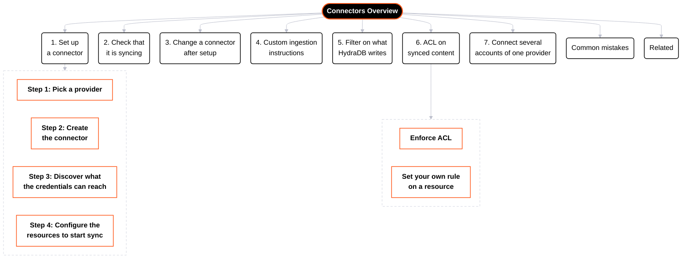

Connect an app and choose which resources (channels, repositories, pages, etc) to sync. HydraDB keeps them synced into your database, with zero ingestion infrastructure and management required at your side. Connectors include Slack, Zoom, Supabase, Gmail, and many more.

## Overview



You don't have to write or maintain ingestion code, infrastructure or organize data. On every sync, HydraDB parses the source, organizes it into a context graph, and tags it with metadata: the connector, the resource, and provider-native fields for eg a Slack message with timestamp or a GitHub issue number.

<a id="how-it-works"></a>

## Setting up a connector

The steps are the same for every provider; only the credentials and resource types change. Set up your [SDK client](/api-reference/v2/sdks#client-setup) first.

### Step 1: Pick a provider

Browse the [connector catalog](/essentials/v2/connector-providers) to see what each connector indexes and any provider-specific setup steps before creating a connection.

[`GET /connectors/providers`](/api-reference/v2/endpoint/list-connector-providers) lists the providers you can connect. Add `?id={provider}` to see the credentials that provider needs (`credential_schema`).

<Accordion title="List providers and describe one: Python, TypeScript, or cURL">

<CodeGroup>
```python Python SDK
catalog = client.list_providers()
slack = client.list_providers(id="slack")
```
```typescript TypeScript SDK
const catalog = await client.listProviders();
const slack = await client.listProviders({ id: "slack" });
```
```bash cURL
curl 'https://api.hydradb.com/connectors/providers' \
  -H "Authorization: Bearer $HYDRADB_API_KEY" \
  -H "API-Version: 2"

curl 'https://api.hydradb.com/connectors/providers?id=slack' \
  -H "Authorization: Bearer $HYDRADB_API_KEY" \
  -H "API-Version: 2"
```
</CodeGroup>

A catalog entry looks like this:

```json
{
  "providers": [
    {
      "provider": "slack",
      "category": "Communication",
      "supported": true,
      "webhook_support": false,
      "rank": 2
    }
  ]
}
```

`webhook_support` is `true` for providers whose data arrives by webhook instead of scheduled syncs, such as Supabase.

</Accordion>

### Step 2: Create the connector

[`POST /connectors`](/api-reference/v2/endpoint/create-connector) saves the credentials and sets the database and collection the data goes to. Nothing syncs yet. Keep the `connector_id` it returns; every later call uses it.

<Accordion title="Create a Slack connector: Python, TypeScript, or cURL">

<CodeGroup>
```python Python SDK
connector = client.connectors.create(
    provider="slack",
    name="acme-engineering",
    database="acme_corp",
    collection="company_docs",
    provider_account_scope="T12345ACME",
    credentials={"access_token": "xoxp-..."},
)
connector_id = connector.connector_id
```
```typescript TypeScript SDK
const connector = await client.connectors.create({
  provider: "slack",
  name: "acme-engineering",
  database: "acme_corp",
  collection: "company_docs",
  providerAccountScope: "T12345ACME",
  credentials: { access_token: "xoxp-..." },
});
const connectorId = connector.connectorId!;
```
```bash cURL
curl -X POST 'https://api.hydradb.com/connectors' \
  -H "Authorization: Bearer $HYDRADB_API_KEY" \
  -H "API-Version: 2" \
  -H "Content-Type: application/json" \
  -d '{
    "provider": "slack",
    "name": "acme-engineering",
    "database": "acme_corp",
    "collection": "company_docs",
    "provider_account_scope": "T12345ACME",
    "credentials": { "access_token": "xoxp-..." }
  }'
```
</CodeGroup>

The response returns the new connector:

```json
{
  "connector_id": "{connector_id}",
  "provider": "slack",
  "name": "acme-engineering",
  "database": "acme_corp",
  "collection": "company_docs",
  "provider_account_scope": "T12345ACME",
  "lifecycle": "pending_setup",
  "sync_status": "idle",
  "sync_interval_seconds": 3600,
  "message": "Connector created. Configure resources to start syncing; the first scheduled sync runs in about 5 minutes."
}
```

</Accordion>

### Step 3: Discover what you can sync from each connector

[`GET /connectors/{id}/discover`](/api-reference/v2/endpoint/discover-connector-resources) lists the resources the credentials can see, such as channels, repositories, or pages. Each entry has an `id`, `name`, and `resource_type`, which you pass to the next call. If a provider has many resources, page with `limit` (1 to 100) and `cursor`, and keep going while `has_more` is `true`.

<Accordion title="Example discover Slack channels: Python, TypeScript, or cURL">

<CodeGroup>
```python Python SDK
found = client.connectors.discover(connector_id)
for resource in found.resources:
    print(resource.id, resource.name, resource.resource_type)
```
```typescript TypeScript SDK
const found = await client.connectors.discover({ id: connectorId });
for (const resource of found.resources ?? []) {
  console.log(resource.id, resource.name, resource.resourceType);
}
```
```bash cURL
curl 'https://api.hydradb.com/connectors/{id}/discover' \
  -H "Authorization: Bearer $HYDRADB_API_KEY" \
  -H "API-Version: 2"
```
</CodeGroup>

```json
{
  "provider": "slack",
  "resources": [
    { "id": "C_GENERAL", "name": "general", "resource_type": "channel" },
    { "id": "C_ENG", "name": "engineering", "resource_type": "channel" }
  ]
}
```

</Accordion>

### Step 4: Configure the resources to sync

[`POST /connectors/{id}/configure`](/api-reference/v2/endpoint/configure-connector) saves the resources you pick and starts the first sync right away.

<Accordion title="Configure two channels: Python, TypeScript, or cURL">

<CodeGroup>
```python Python SDK
result = client.connectors.configure(
    connector_id,
    lookback_days=30,
    resources=[
        {
            "resource_id": "C_GENERAL",
            "resource_type": "channel",
            "name": "general",
            "metadata": {"department": "all-hands"},
            "additional_metadata": {"internal_label": "general-slack"},
        },
        {
            "resource_id": "C_ENG",
            "resource_type": "channel",
            "name": "engineering",
            "metadata": {"department": "engineering"},
        },
    ],
)
print(result.configured)
```
```typescript TypeScript SDK
const result = await client.connectors.configure({
  id: connectorId,
  lookbackDays: 30,
  resources: [
    {
      resourceId: "C_GENERAL",
      resourceType: "channel",
      name: "general",
      metadata: { department: "all-hands" },
      additionalMetadata: { internal_label: "general-slack" },
    },
    {
      resourceId: "C_ENG",
      resourceType: "channel",
      name: "engineering",
      metadata: { department: "engineering" },
    },
  ],
});
console.log(result.configured);
```
```bash cURL
curl -X POST 'https://api.hydradb.com/connectors/{id}/configure' \
  -H "Authorization: Bearer $HYDRADB_API_KEY" \
  -H "API-Version: 2" \
  -H "Content-Type: application/json" \
  -d '{
    "lookback_days": 30,
    "resources": [
      {
        "resource_id": "C_GENERAL",
        "resource_type": "channel",
        "name": "general",
        "metadata": { "department": "all-hands" },
        "additional_metadata": { "internal_label": "general-slack" }
      },
      {
        "resource_id": "C_ENG",
        "resource_type": "channel",
        "name": "engineering",
        "metadata": { "department": "engineering" }
      }
    ]
  }'
```
</CodeGroup>

```json
{
  "connector_id": "{connector_id}",
  "configured": 2,
  "backfill": false,
  "first_sync_at": "2026-06-01T13:00:00Z",
  "message": "First sync is running. Data usually appears within a few minutes; the connector reports lifecycle 'ingesting' until data has synced."
}
```

`configured` is the number of resources saved. A `warnings` list names resources that were saved but returned no records when HydraDB tested them; they stay configured and index nothing until they have data.

</Accordion>

### What does each property mean

| Property | Set in | Meaning |
| --- | --- | --- |
| `provider` | create | Which app, such as `slack`. |
| `provider_account_scope` | create | A stable account identifier supplied by your application. Distinct accounts need distinct values to avoid collisions between matching external IDs in the same destination. The API does not derive or validate the native account identity. See [account scopes](#6-connect-several-accounts-from-one-provider). |
| `credentials` | create | The app's credentials, in the shape of its `credential_schema`. |
| `custom_instructions` | create, configure | How to interpret synced documents. See [section 4](#4-custom-ingestion-instructions). |
| `sync_interval_seconds` | create | How often it syncs. The default is 1 hour for most providers. |
| `enforce_acl` | create, update | Filter reads by the caller's identity. Defaults to `false`; enabling it requires `acl_supported: true`. Only signed-in human workspace owners and writers can supply this field, even `false`. API-key clients must omit it. See [Enforce ACL](#5-acl-native-rbac-awareness). |
| `lookback_days` | configure | How much history the first sync fetches. The default is 30 days. |
| `resource_id`, `resource_type`, `name` | configure | Copied from discover. Send all three every time you list a resource. |
| `acl` | configure | Who can read the ingested resource. By default ACLs are mirrored from the apps. If you omit it, anyone can read. |

<a id="provider_account_scope"></a>

## 2. Syncing

[`GET /connectors/{id}/status`](/api-reference/v2/endpoint/get-connector-status) reports the connector and each resource. `lifecycle` reads as `ingesting` until the first sync ingests data fully, then it says `active`. Query the data once it's `active`.

After that, HydraDB syncs every `sync_interval_seconds` (1 hour by default). Call `POST /connectors/{id}/sync` to sync now, or change the interval with `PATCH /connectors/{id}`.

<a id="changing-a-connector-after-setup"></a>

## 3. Making changes to setup

| To change | Call |
| --- | --- |
| A resource's ACL rule | [`PATCH /connectors/{id}/resources/{resource_id}`](/api-reference/v2/endpoint/update-connector-resource) |
| Connector custom ingestion instructions, interval, or credentials | [`PATCH /connectors/{id}`](/api-reference/v2/endpoint/update-connector). Sending new credentials reconnects it and keeps its resources. |
| Stop syncing a resource. | [Delete Connector Resource](/api-reference/v2/endpoint/delete-connector-resource). You can also look into [Pause](/api-reference/v2/endpoint/pause-connector) or [Resume](/api-reference/v2/endpoint/resume-connector). Nothing created in the meantime is skipped. |
| Deleting the entire connector | [Delete Connector](/api-reference/v2/endpoint/delete-connector) |

<a id="custom-ingestion-instructions"></a>

## 4. Custom ingestion instructions

Custom instructions tell HydraDB how to read your synced documents and what to look for. They change how documents are interpreted, not what gets ingested. For example:

- "Aurora was renamed to Nimbus; they are the same product."
- "Customer support Slack threads contain typos and mix up accounts, so be careful when creating relationships."

**Instructions apply to future syncs only.** Documents that are already indexed keep the instruction they were ingested under.

<Accordion title="Setting an instruction on a connector: Python, TypeScript, or cURL">
  <CodeGroup>

  ```python Python SDK
  client.connectors.update(
      connector_id,
      custom_instructions=(
          "Aurora was renamed to Nimbus in January 2025; they are the same product. "
          "Index all Aurora content under the canonical name Nimbus and record Aurora as a former name."
      ),
  )
  ```

  ```typescript TypeScript SDK
  await client.connectors.update({
    id: connectorId,
    customInstructions:
      "Aurora was renamed to Nimbus in January 2025; they are the same product. " +
      "Index all Aurora content under the canonical name Nimbus and record Aurora as a former name.",
  });
  ```

  ```bash cURL
  curl -X PATCH 'https://api.hydradb.com/connectors/{id}' \
    -H "Authorization: Bearer $HYDRADB_API_KEY" \
    -H "API-Version: 2" \
    -H "Content-Type: application/json" \
    -d '{
      "custom_instructions": "Aurora was renamed to Nimbus in January 2025; they are the same product. Index all Aurora content under the canonical name Nimbus and record Aurora as a former name."
    }'
  ```

  </CodeGroup>
</Accordion>

<a id="metadata-on-synced-objects"></a>
<a id="inspect-what-a-connector-stores"></a>
<a id="4-filter-on-what-hydradb-writes"></a>

## 5. ACL (native RBAC awareness)

Connectors capture provider permissions where the provider supports them. If permissions cannot be resolved, affected content without another valid ACL remains public with a persistent visible status warning. Existing valid private ACLs and revocations remain enforced.

<a id="enforce-acl"></a>

`enforce_acl: true` filters reads by the authenticated caller's identity and ignores any request `acl` for this connector's content.

Only a signed-in human workspace owner or writer can supply `enforce_acl` on create or update. API-key clients must omit the field: even `false` invokes the same authorization guard and is rejected. To change the setting, sign in to the dashboard, open the connector's settings, and use **Enforce ACL**. Omission defaults to `false` on creation; enabling it requires a provider reporting `acl_supported: true`.

### Examples of what each provider captures

- **Slack:** Public channels are visible workspace-wide; private channels only to their members.
- **Google Drive**: Per-file sharing: user, group, domain, and public grants.
- **Confluence:** Space view permissions and per-page restrictions.

and so forth. For other providers, check `acl_supported` in the [provider catalog](/api-reference/v2/endpoint/list-connector-providers). For a provider that does not capture permissions, [set your own rule on the resource](#set-your-own-rule-on-a-resource).

<Callout icon="computer-classic" color="#FF5719">
  While `enforce_acl` is `false` (the default), a request without `acl` is **not** filtered by caller identity. Send identity in `acl`, or ask a signed-in human workspace owner or writer to enable **Enforce ACL** in the dashboard connector settings. Do not send `enforce_acl: false` as an API-key workaround.
</Callout>

### Set your own rule on a resource

Send `acl` to [`PATCH /connectors/{id}/resources/{resource_id}`](/api-reference/v2/endpoint/update-connector-resource). It applies to already-synced sources on the next query, with no re-sync.

- A source's own permissions from the provider replace your rule at the next sync.
- A resource with no rule is readable by everyone.

<Accordion title="Example restrict one channel to one person: Python, TypeScript, or cURL">

<CodeGroup>
```python Python SDK
client.connectors.update_resource_acl(
    connector_id, "C_LEADERSHIP", request={"acl": ["grace@acme.com"]}
)
```
```typescript TypeScript SDK
await client.connectors.updateResourceAcl({
  id: connectorId,
  resourceId: "C_LEADERSHIP",
  acl: ["grace@acme.com"],
});
```
```bash cURL
curl -X PATCH 'https://api.hydradb.com/connectors/{id}/resources/C_LEADERSHIP' \
  -H "Authorization: Bearer $HYDRADB_API_KEY" \
  -H "API-Version: 2" \
  -H "Content-Type: application/json" \
  -d '{ "acl": ["grace@acme.com"] }'
```
</CodeGroup>

</Accordion>

### Restore resource permissions

<Warning>
  This takes effect immediately, and it can widen access if the resource allows more people than the source's own ACL did.
</Warning>

Send `acl_inherit: true`, without `acl`, to [Update Source Metadata](/api-reference/v2/endpoint/update-source-metadata). The source goes back to following its resource's rule.

```bash cURL
curl -X PATCH 'https://api.hydradb.com/context/confluence-page-9f62/metadata' \
  -H "Authorization: Bearer $HYDRADB_API_KEY" \
  -H "API-Version: 2" \
  -H "Content-Type: application/json" \
  -d '{
    "database": "acme_corp",
    "collection": "engineering",
    "acl_inherit": true
  }'
```

<a id="multiple-connectors-per-provider"></a>
<a id="6-connect-several-accounts-of-one-provider"></a>

## 6. Connect several accounts from one provider

Create one connector per account, each with that account's own credentials and resources. A connector does not combine several accounts' credentials. Give distinct accounts of the same scoped provider different `provider_account_scope` values; reusing a scope can cause sources with the same external ID to overwrite each other in a shared destination.

For Slack, GitHub, Linear, and Notion, choose a stable account, workspace, or organization identifier and keep its mapping to the connector in your application. The API stores the supplied scope; it does not derive or validate the native account identity or reject duplicate scopes. These caller-provided examples illustrate distinct values, not required provider-specific syntax:

| Provider | Account A example | Account B example |
| --- | --- | --- |
| `slack` | `slack-account-a` | `slack-account-b` |
| `github` | `github-account-a` | `github-account-b` |
| `linear` | `linear-account-a` | `linear-account-b` |
| `notion` | `notion-account-a` | `notion-account-b` |

Several connectors can write to the same database and collection. Filter on `connector_id` to select one connector/account in a query. Database and collection routing choose where content lands; collection names do not authorize access. Apply the caller's authenticated scope and ACL rules to reads and mutations.

## Advanced (mostly for agents)

<AccordionGroup>
  <Accordion title="Provider catalog">
    - `filterable_fields` each carry the `filter_key` to use in `metadata_filters`.
    - `searchable_fields` are combined into each document's searchable text, so you search them together, not one at a time.
    - `acl_supported` and `acl_description` report whether a provider's permissions are captured. Capture is also built for GitLab, Linear, Dropbox, Zendesk, PagerDuty, Typeform, Attio, LaunchDarkly, ServiceNow, Microsoft Teams, and Outlook, and is switched on per provider.
  </Accordion>

  <Accordion title="Setup responses">
    - **Create:** a new connector starts with `lifecycle: pending_setup` and `sync_status: idle`.
    - **Discover:** providers that sync a whole account return one entry with `id` `all`.
    - **Backfill:** with `lookback_days` above 30, some providers fetch older history in the background and report `backfill: true`.
  </Accordion>

  <Accordion title="Property details">
    - **Credentials:** credentials that don't match `credential_schema` are rejected with `422`.
    - **Routing:** each resource can route to its own `collection` or `database`.
    - **Account scope:** the supplied `provider_account_scope` is part of a synced source's identity. Distinct scopes keep matching external IDs from different accounts separate in the same destination; reusing a scope can cause overwrites.
  </Accordion>

  <Accordion title="Sync behavior">
    - **Status:** `status` is the overall health, such as `healthy`, `degraded`, or `failed`. Each resource reports its own result, with an `action` when it failed. See [Get Connector Status](/api-reference/v2/endpoint/get-connector-status).
    - **Incremental sync:** each sync fetches only what changed since the resource's saved position (its cursor).
    - **Manual sync:** a `202` from `POST /connectors/{id}/sync` means the sync started, not that it finished.
    - **Pause and resume:** after a pause, each resource resumes from its saved position.
    - **Reconfiguring:** configuring again keeps each resource's sync position, instructions, and ACL.
  </Accordion>

  <Accordion title="Instruction details">
    - **Length limit:** up to 4,000 characters. Longer values are rejected with `400`, and the stored value stays as it was.
    - **Cost:** the text goes into the extraction prompt for every synced document, so keep it short.
    - **Be explicit:** name the exact terms, and keep unrelated rules in separate sentences.
    - **Checking instructions:** `GET /connectors/{id}` returns the connector's instruction. `GET /connectors/{id}/resources` returns each resource's, which is absent when the resource inherits. The dashboard's **Instructions** dialog marks each resource as **override** or **inherits**.
  </Accordion>

  <Accordion title="Metadata layers">
    - **`metadata`:** HydraDB writes `connector_id` and `provider` here, and they win over your own fields on conflict.
    - **`additional_metadata`:** HydraDB writes `connector_id`, `resource_id`, and provider-native fields here, and provider-generated fields win over yours on conflict.
  </Accordion>

  <Accordion title="ACL details">
    - **Without enforcement:** while `enforce_acl` is `false`, the request `acl` still scopes this connector's content, even when the same request reads from enforced connectors. MCP OAuth doesn't enforce caller identity for non-enforced connectors.
    - **Identity under enforcement:**
      - API key or pasted-key MCP: the email of the person who created the key.
      - MCP OAuth and the dashboard: the signed-in user.
    - **Ignored `acl`:** when a request's `acl` is ignored because of enforcement, the response includes one warning:
      ```json
      { "meta": { "warnings": [{ "code": "acl_ignored_by_connector_enforcement", "message": "This connector enforces ACL, so the request's acl was ignored." }] } }
      ```
    - **Support withdrawn:** if a provider stops reporting `acl_supported`, its connectors stop enforcing within about a minute and keep their stored setting. Enforcement resumes when support returns.
    - **API key revocation:** when a member leaves or is removed from the workspace, every API key they created there is revoked. Re-inviting them doesn't restore those keys.
    - **Read failures:** if HydraDB can't read a resource's permissions, Get Connector Status reports an `acl_warning` until the next successful read.
    - **Opening a resource:** deleting a resource rule doesn't widen access. To open a restricted resource, set its ACL to `["__public__"]`.
    - **Inheritance limits:** `acl` combined with `acl_inherit: true` is invalid. Uploads and manually ingested sources can't inherit. Provider permissions can replace inherited state on a later sync, because the last write wins.
  </Accordion>

  <Accordion title="Several accounts">
    All connectors can sync into the same collection, so one query searches every account. If one account's data must never appear alongside the others in a query, set `collection` per resource in configure.
  </Accordion>

  <Accordion title="Common mistakes while setting up connectors">
    - **Editing a resource with `POST /connectors/{id}/resources`:** it returns `409` and changes nothing. Use `PATCH /connectors/{id}/resources/{resource_id}` instead, or configure again.
    - **Configuring again without `name` and `resource_type`:** omitted values are cleared.
    - **Expecting a resource instruction to add to the connector default:** it replaces the default.
    - **Two accounts with the same** `provider_account_scope`**:** their sources overwrite each other.
    - **Filtering a provider field as a top-level key:** provider-native fields live in `additional_metadata`. Use the `filter_key` from the provider description.
    - **Querying before `lifecycle` is `active`:** the first sync hasn't landed yet.
  </Accordion>
</AccordionGroup>
